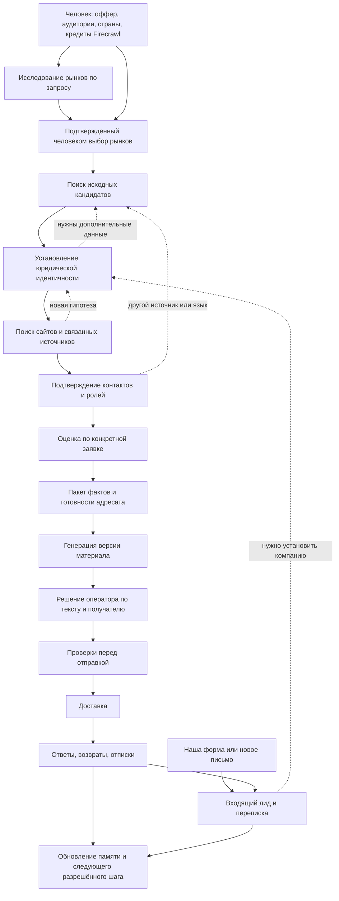

# 1. Видение продукта и исследовательские сценарии

## 1.1. Что пользователь получает

Продукт получает поручение в терминах бизнеса: «Мы предлагаем внедрение CRM для строительных подрядчиков; нужны компании с собственным отделом продаж в выбранных странах». Результат — проверяемый список компаний, объяснение соответствия этой заявке, подходящие каналы связи, подготовленные материалы и наблюдаемый статус разрешённых коммуникаций.

Другой вход — человек сам обратился через нашу форму или email. Такое обращение создаёт/дополняет inbound lead и переписку, даже когда юрлицо ещё неизвестно. Дальнейшее исследование помогает установить компанию и потребность; оно не выдаёт входящее сообщение за новую утверждённую поисковую заявку.

Для каждой компании доступны:

- юридическая идентичность и известные регистрационные номера;
- бренд, связанные сайты, филиалы и рынки присутствия;
- фактические признаки бизнеса, важные для конкретного оффера;
- контакты с принадлежностью, ролью, источником и актуальностью;
- цепочка исследования: откуда начали, почему проверили следующий источник, что подтвердили;
- пробелы, противоречия и необходимое человеческое решение;
- отдельные статусы исследования, адресата, материала, утверждения и доставки.

Система умеет сказать «обнаружена компания, но принадлежность email не подтверждена». Такой результат полезен для продолжения исследования и не увеличивает счётчик готовых адресатов.

## 1.2. Полный жизненный цикл



Петли ограничены сроком, числом действий и предметной полезностью; денежный бюджет приложения применяется только к Firecrawl. Остальные инструменты используют существующий proxy. Один и тот же цикл не должен бесконечно повторяться с переставленными словами запроса.

## 1.3. Центральный сценарий: ИНН → компания → сайт → чужая карточка → контакт

Синтетический пример: известен регистрационный номер `<номер-A>` компании в России.

1. Проверить, что это номер нужного типа и юрисдикции. Корректная контрольная сумма означает пригодность для поиска, а не существование компании.
2. Запросить доступный реестровый источник. Получить юридическое название, статус и необходимые признаки. Сохранить результат с датой и областью доступа.
3. Найти возможные бренды и домены по номеру, названию, адресу и контексту деятельности.
4. На `company-a.example/requisites` найти тот же номер именно в реквизитах организации. Это основание связи домена и юрлица.
5. На сайте контакта нет. Поискать номер, варианты названия и бренд в деловых каталогах и иных разрешённых источниках.
6. На `directory.example/company/a` найти структурированную карточку: тот же номер, юридическое название, регион и email в блоке контактов этой карточки.
7. Проверить, что email относится к компании A. Email владельца каталога в footer не подходит. Если email использует посторонний домен, исследовать его отношение к A либо оставить связь предварительной.
8. Сохранить цепочку `источник реестра → юрлицо A → карточка каталога A → контакт A`, раздельно от цепочки домена.
9. Определить актуальность и пригодность выбранного канала. Существование контакта, его принадлежность и доставляемость — разные проверки.
10. Вернуть проверяемый результат и пробелы. Сайт компании может оставаться неизвестным: цепочка через реестровую карточку способна подтвердить контакт независимо от наличия собственного сайта.

Требовать сайт во всех случаях нельзя: некоторые реальные компании используют только профиль, торговую площадку, форму или бизнес-страницу. Требовать доказательства принадлежности контакта нужно всегда.

## 1.4. Варианты исходных данных

| Исходное знание | Следующие полезные действия | Что нельзя считать доказательством |
|---|---|---|
| Регистрационный номер | Проверка юрисдикции, реестр, реквизиты, профиль компании | Любая встреча цифр на странице |
| Юридическое название | Реестр, регион/адрес, варианты написания, бренд | Одноимённое название без идентификаторов |
| Бренд | Legal/imprint/privacy/requisites, trade-name registry, локальные сайты | Равенство бренда и одного юрлица |
| Домен | Company footer, legal pages, внешние профили с обратными ссылками | Один redirect или общая аналитика |
| Email | Источник публикации, домен, организация/роль, проверка адреса | Формат `имя@домен`, предположенный LLM |
| Телефон | Страновой контекст, формат, публичная карточка субъекта | Похожие числовые ID и общая АТС |
| Адрес | Реестр, карта/каталог, филиал, организация в здании | Общий business center или массовый адрес |
| Профиль/публикация | Указанная организация, ссылки, номер, автор/издатель | Реквизиты издателя как данные героя публикации |
| Имя сотрудника и роль | Профессиональная принадлежность и актуальность на публичном источнике | Предположение по имени, национальности или частным данным |

## 1.5. Дополнительные интеллектуальные связки

**Ребрендинг.** Старое название → сообщение о переименовании → неизменный регистрационный номер → новое название и домен. Старое имя остаётся историческим alias, а старый сайт получает временную связь.

**Группа компаний.** Бренд → юридические лица разных стран → связь владения/представительства → локальный адресат. Контакт головной компании не автоматически становится контактом дочерней.

**Региональный филиал.** Один ИНН и несколько КПП / один SIREN и несколько SIRET → разные площадки → локальные телефоны. Цели по компаниям и филиалам имеют разные единицы подсчёта; запрошенный объём задаётся конкретной заявкой.

**Межъязыковой поиск.** Английское торговое имя → локальное юридическое имя → местный реестр → локальный сайт → переводимые факты. Исходное написание сохраняется; перевод служит alias для поиска.

**Поиск по документам.** Тендер/сертификат/публичный PDF → номер организации и роль участника → реестр → официальный сайт → контакты. Контакт составителя документа и контакт участника различаются.

**Смена сайта.** Старый URL → redirect → новые реквизиты → подтверждение стабильного субъекта. Redirect без реквизитов может вести на проданный домен и не подтверждает идентичность.

**Профессиональное событие.** Список участников выставки → компания и стенд → официальный профиль участника → локальное представительство → business contact. Участие является сигналом активности, а не готовностью купить.

**Сайт без реквизитов.** Несколько согласованных источников, ссылки в реестре/официальном профиле, товарный знак и роль сайта могут дать основание связи. Неполнота должна оставаться видимой; недостающий номер нельзя выдумывать.

**Контакт за формой.** Подтверждённая контактная форма фиксируется как канал. Она не превращается в email, а отправка формы требует своего разрешённого сценария и результата.

**Отказ адреса.** Bounce → пометка конкретного endpoint → поиск замены/общего отдела → новый адресат и новый материал/решение. Компания при этом остаётся существующей.

**Возврат из памяти.** Ранее исследованная компания → проверка актуальности нужных полей → дозаполнение пробела → применение новых критериев заявки. Старая оценка аудитории не переносится автоматически.

## 1.6. Пользовательский интерфейс

Форма поручения содержит оффер, описание нужных компаний, исключения, страны, смысл присутствия на рынке, языки, единицу цели, кредиты Firecrawl и технические caps. Россия выбрана изначально. Отдельная кнопка «Исследовать международный рынок» открывает рекомендации, не меняя заявку без выбора пользователя.

Экран исполнения показывает четыре связанные области:

1. **Миссия:** цель, страны, критерии, версии, расходы, лимиты и результат.
2. **Текущее исследование:** компания/гипотеза, следующий проверяемый вопрос, источник, язык, состояние инструмента.
3. **Dossier компании:** сущности, контакты, подтверждения, конфликты и история.
4. **Коммуникация:** подготовленный материал, получатель, решение, очередь доставки и события.

Основные счётчики: поисковые находки → кандидаты → различимые компании → подтверждённые компании → компании с контактами → email-ready → материалы → утверждённые действия → отправленные/принятые → ответы. Один общий процент скрывает разные виды незавершённости.

Отображение причины важно: «Проверяем, принадлежит ли email компании с данным номером», «Доступен телефон, но нет email», «Нужен источник на немецком», «Ожидается решение по противоречащим реквизитам».

## 1.7. Что значит интеллектуальность

Интеллектуальность выражается в выборе проверки с максимальной ожидаемой полезностью: установить личность компании, устранить конкретное противоречие, найти недостающий канал, проверить устаревший факт. Количество LLM-вызовов и глубина обхода сами по себе не являются результатом.

Для каждого действия система хранит короткое обоснование и ожидаемый результат, например: «В карточке есть регистрационный номер, но связь домена не подтверждена; проверяем legal page». Закрытые рассуждения модели не нужны для предметного аудита.

Система обязана уметь остановиться с частичным ответом. Полный dossier одной правильной компании полезнее нескольких ошибочно объединённых записей, поскольку ошибка связывания затем распространяется на персонализацию и отправку.

## 1.8. Сквозной сценарий: поиск от номера до контакта

Все значения ниже условные; `.example` не являются источниками для реального запуска. Сценарий определяет ожидаемое поведение будущего прототипа.

| Шаг | Что система узнала | Следующее действие | Что видит человек |
|---|---|---|---|
| 1 | Введён номер `<номер-A>`, RU и оффер | Проверить тип номера и допустимый registry lookup | «Проверяем организацию по номеру» |
| 2 | Источник подтвердил юрлицо A и название | Найти источники сайта/канала по точным признакам | Название, номер, источник и время |
| 3 | На `a.example/legal` есть тот же ID, контакта нет | Читать contact page либо искать ID в других источниках | «Сайт связан с компанией; контакт ещё не найден» |
| 4 | Каталог содержит A, email A и footer издателя B | Выделить карточку A и проверить локальный субъект | Обе находки различены; footer B не засчитан |
| 5 | Email находится в карточке с тем же ID | Проверить символы/формат/роль/актуальность | «Принадлежность подтверждена; канал проверяется» |
| 6 | Dossier и evidence устойчиво сохранены | Засчитать одну company-with-contact единицу | Одна карточка, цепочка источников, 1 результат |
| 7 | Разрешённый пакет фактов готов | Подготовить материал по отдельному действию | Черновик с адресатом, языком и основаниями |

Если шаг 3 не дал сайт, шаг 4 всё равно может подтвердить контакт через корректную внешнюю карточку. Если на шаге 5 обнаружен конфликт, результат остаётся кандидатом с причиной и не увеличивает зачёт. Повтор шага 6 не создаёт вторую компанию.

## 1.9. Сквозной сценарий: другой рынок и неоднозначные данные

Введено немецкое торговое имя. Интерфейс русский, язык запроса немецкий, target market DE. Найдены две организации с похожим названием и `HRB <номер>`, но разные register courts. Система сохраняет две кандидатуры, запрашивает уточняющий legal/imprint источник и не объединяет их по имени/цифрам.

Контакт одного кандидата находится в изображении. DOM не содержит текста, поэтому запускается разрешённый OCR profile. Если адрес прочитан как `sales@acrne.example` и `sales@acme.example`, оператор видит crop и варианты; готовый email не выбирается LLM по правдоподобию. Дополнительный источник может разрешить символы; иначе результат остаётся на review.

Если требуемый региональный выход недоступен, видно конкретное ограничение acquisition. Подмена DE на RU или генерация письма неподтверждённому кандидату не закрывают шаг.

## 1.10. Как показывать объём и прогресс заявки

Целевой объём `N` задаёт человек в конкретной заявке; общего фиксированного числа результатов нет. Зачёт зависит от выбранной единицы: компания, компания с подтверждённым контактом либо email-ready компания. Для каждой единицы учитываются свои критерии принятия; недобор равен `max(0, N − зачёт)`.

Предлагаемый блок в существующем экране «Заявки / Исполнение»:

```text
Запрошено: <объём из заявки> компаний с подтверждённым контактом · RU
Засчитано: 6 · Осталось: <рассчитанный недобор>
Кандидаты сохранены: 17 · С подтверждённым каналом: 6

Сейчас: проверяем принадлежность email компании A
Последний результат: найдены реквизиты в карточке каталога
Ожидание: ответ источника · Следующая попытка: <время, если известно>
Материалы: <число сохранённых черновиков> · Решение/отправка: отдельные статусы
```

Числа кандидатов и принятых результатов здесь иллюстрируют разные счётчики, а не обязательный размер выборки. Каждый счётчик открывает именно свой список. «Сохранено» означает подтверждённый результат записи, а не предварительное regex-извлечение. Если получено 17 сигналов, а записано 6, UI показывает оба числа и ошибку этапа записи. Неуспешная запись не маскируется движением общего процента.

У сохранённых кандидатов есть стабильные карточки в проекции исследования. Не прошедшие проверку видны с причиной: «не различена организация», «контакт принадлежит издателю», «OCR неоднозначен», «ожидается источник». У готовых — цепочка свидетельств. Переход к legacy карточке возможен только при корректном mapping, без фиктивного домена для неизвестной компании.

Экран «Лиды» явно показывает область и фильтр: все кандидаты этой заявки / подтверждённые / с каналом / с email. Оценка соответствия показывается с названием заявки и критериями; глобальная категория «подходящие компании» не вводится.

Если исчерпаны кредиты Firecrawl, UI показывает недоступность этого инструмента; разрешённые memory/proxy/self-hosted пути продолжаются. Когда полезных допустимых действий больше нет либо достигнут deadline, надпись меняется на «Исследование завершено частично» с фактическим зачётом, запрошенным объёмом и конкретной причиной. Статус формальной заявки и состояние подготовки материалов остаются отдельными. Heartbeat без новых данных отображается как живой исполнитель с давним последним результатом; ETA не придумывается.

## 1.11. Сквозной сценарий: входящее обращение

Посетитель нашей формы оставил email и сообщение: «Нужна стоимость внедрения для двух офисов». Компания не указана. Возникают inquiry, контакт и входящий lead candidate; происхождение — конкретная форма/страница. Число «два» относится к офисам, не к цели поиска лидов.

Оператор видит обращение во «Входящих», связывает организацию при наличии основания и готовит ответ. После утверждённой отправки ответ посетителя попадает в ту же timeline по проверяемой корреляции. Сообщение «пришлите условия» выделяется как вопрос/интерес, а фраза «напишите в ноябре» — как условие продолжения с исходной цитатой.

Другой случай: компания отвечает на наш исходящий email «Не актуально, больше не пишите». Новый lead не создаётся. Ответ сохраняется, применимый follow-up останавливается, адресат/кампания получают причину. Аналитика отличает этот человеческий отказ от автоответа и bounce.

У переписки видны направление и источник сообщения, связь с контактом/компанией, статус «нужен наш ответ» / «ожидаем ответ» / «приостановлено», ответственный и следующее разрешённое действие. Предполагаемую связь можно исправить; история исправления сохраняется.

## 1.12. Сквозной сценарий: контакт найден спустя время

В первый день источник A дал компанию и подтверждённый регистрационный номер. Контакта нет: компания видна в списке сохранённых кандидатов, а её досье показывает пробел «найти email». Она может не засчитываться в цель «компания с контактом», сохраняя собственную идентичность и историю исследования.

После завершения этой заявки другая разрешённая работа через время находит источник B с тем же номером и email. Система проверяет субъект контактного блока, связывает email с прежней компанией и закрывает подходящую потребность. Если доказательств недостаточно, показывает кандидата связи и нужную проверку. В обоих случаях находка не теряется.

Пользователь видит ленту «компания обнаружена → контакта не было в проверенном источнике → email найден позже → принадлежность подтверждена» и отдельные статусы формата, достижимости и актуальности. На странице завершённой заявки остаётся исторический итог, рядом доступно актуальное досье с поздним обогащением. Новая находка сама не отправляет письмо и не создаёт новую заявку.

Если основание связи позже опровергнуто, лента показывает пересмотр, зависимые текущие проекции обновляются, а нужный пробел открывается вновь. Полная модель отношений и зависимостей описана в [§2.13](02-identity-and-evidence.md#213-сеть-отношений-и-зависимостей-во-времени), исполнение — в [§3.16](03-agent-and-memory.md#316-открытые-потребности-и-событийное-дообогащение).
