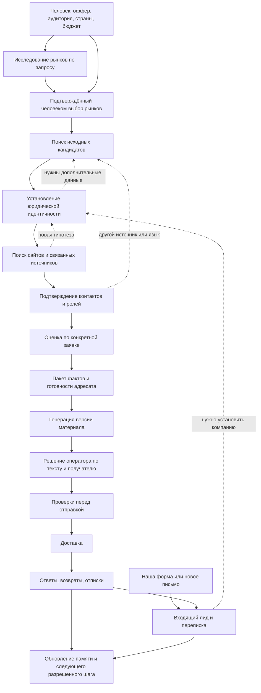

# 1. Видение продукта и исследовательские сценарии

## 1.1. Что пользователь получает

Продукт получает поручение в терминах бизнеса: «Мы предлагаем внедрение CRM для строительных подрядчиков; нужны компании с собственным отделом продаж в выбранных странах». Результат — проверяемый список компаний, объяснение соответствия этой заявке, подходящие каналы связи, подготовленные материалы и наблюдаемый статус разрешённых коммуникаций.

Другой вход — человек сам обратился через нашу форму или email. Такое обращение создаёт/дополняет inbound lead и переписку, даже когда юрлицо ещё неизвестно. Дальнейшее исследование помогает установить компанию и потребность; оно не выдаёт входящее сообщение за новую утверждённую поисковую заявку.

Для каждой компании доступны:

- юридическая идентичность и известные регистрационные номера;
- бренд, связанные сайты, филиалы и рынки присутствия;
- фактические признаки бизнеса, важные для конкретного оффера;
- контакты с принадлежностью, ролью, источником и актуальностью;
- цепочка исследования: откуда начали, почему проверили следующий источник, что подтвердили;
- пробелы, противоречия и необходимое человеческое решение;
- отдельные статусы исследования, адресата, материала, утверждения и доставки.

Система умеет сказать «обнаружена компания, но принадлежность email не подтверждена». Такой результат полезен для продолжения исследования и не увеличивает счётчик готовых адресатов.

## 1.2. Полный жизненный цикл

Петли ограничены бюджетом, числом действий и предметной полезностью. Один и тот же цикл не должен бесконечно повторяться с переставленными словами запроса.

## 1.3. Центральный сценарий: ИНН → компания → сайт → чужая карточка → контакт

Синтетический пример: известен регистрационный номер `<номер-A>` компании в России.

1. Проверить, что это номер нужного типа и юрисдикции. Корректная контрольная сумма означает пригодность для поиска, а не существование компании.
2. Запросить доступный реестровый источник. Получить юридическое название, статус и необходимые признаки. Сохранить результат с датой и областью доступа.
3. Найти возможные бренды и домены по номеру, названию, адресу и контексту деятельности.
4. На `company-a.example/requisites` найти тот же номер именно в реквизитах организации. Это основание связи домена и юрлица.
5. На сайте контакта нет. Поискать номер, варианты названия и бренд в деловых каталогах и иных разрешённых источниках.
6. На `directory.example/company/a` найти структурированную карточку: тот же номер, юридическое название, регион и email в блоке контактов этой карточки.
7. Проверить, что email относится к компании A. Email владельца каталога в footer не подходит. Если email использует посторонний домен, исследовать его отношение к A либо оставить связь предварительной.
8. Сохранить цепочку `источник реестра → юрлицо A → карточка каталога A → контакт A`, раздельно от цепочки домена.
9. Определить актуальность и пригодность выбранного канала. Существование контакта, его принадлежность и доставляемость — разные проверки.
10. Вернуть проверяемый результат и пробелы. Сайт компании может оставаться неизвестным: цепочка через реестровую карточку способна подтвердить контакт независимо от наличия собственного сайта.

Требовать сайт во всех случаях нельзя: некоторые реальные компании используют только профиль, торговую площадку, форму или бизнес-страницу. Требовать доказательства принадлежности контакта нужно всегда.

## 1.4. Варианты исходных данных

| Исходное знание | Следующие полезные действия | Что нельзя считать доказательством |
|---|---|---|
| Регистрационный номер | Проверка юрисдикции, реестр, реквизиты, профиль компании | Любая встреча цифр на странице |
| Юридическое название | Реестр, регион/адрес, варианты написания, бренд | Одноимённое название без идентификаторов |
| Бренд | Legal/imprint/privacy/requisites, trade-name registry, локальные сайты | Равенство бренда и одного юрлица |
| Домен | Company footer, legal pages, внешние профили с обратными ссылками | Один redirect или общая аналитика |
| Email | Источник публикации, домен, организация/роль, проверка адреса | Формат `имя@домен`, предположенный LLM |
| Телефон | Страновой контекст, формат, публичная карточка субъекта | Похожие числовые ID и общая АТС |
| Адрес | Реестр, карта/каталог, филиал, организация в здании | Общий business center или массовый адрес |
| Профиль/публикация | Указанная организация, ссылки, номер, автор/издатель | Реквизиты издателя как данные героя публикации |
| Имя сотрудника и роль | Профессиональная принадлежность и актуальность на публичном источнике | Предположение по имени, национальности или частным данным |

## 1.5. Дополнительные интеллектуальные связки

**Ребрендинг.** Старое название → сообщение о переименовании → неизменный регистрационный номер → новое название и домен. Старое имя остаётся историческим alias, а старый сайт получает временную связь.

**Группа компаний.** Бренд → юридические лица разных стран → связь владения/представительства → локальный адресат. Контакт головной компании не автоматически становится контактом дочерней.

**Региональный филиал.** Один ИНН и несколько КПП / один SIREN и несколько SIRET → разные площадки → локальные телефоны. Цель «25 компаний» и цель «25 филиалов» имеют разную единицу подсчёта.

**Межъязыковой поиск.** Английское торговое имя → локальное юридическое имя → местный реестр → локальный сайт → переводимые факты. Исходное написание сохраняется; перевод служит alias для поиска.

**Поиск по документам.** Тендер/сертификат/публичный PDF → номер организации и роль участника → реестр → официальный сайт → контакты. Контакт составителя документа и контакт участника различаются.

**Смена сайта.** Старый URL → redirect → новые реквизиты → подтверждение стабильного субъекта. Redirect без реквизитов может вести на проданный домен и не подтверждает идентичность.

**Профессиональное событие.** Список участников выставки → компания и стенд → официальный профиль участника → локальное представительство → business contact. Участие является сигналом активности, а не готовностью купить.

**Сайт без реквизитов.** Несколько согласованных источников, ссылки в реестре/официальном профиле, товарный знак и роль сайта могут дать основание связи. Неполнота должна оставаться видимой; недостающий номер нельзя выдумывать.

**Контакт за формой.** Подтверждённая контактная форма фиксируется как канал. Она не превращается в email, а отправка формы требует своего разрешённого сценария и результата.

**Отказ адреса.** Bounce → пометка конкретного endpoint → поиск замены/общего отдела → новый адресат и новый материал/решение. Компания при этом остаётся существующей.

**Возврат из памяти.** Ранее исследованная компания → проверка актуальности нужных полей → дозаполнение пробела → применение новых критериев заявки. Старая оценка аудитории не переносится автоматически.

## 1.6. Пользовательский интерфейс

Форма поручения содержит оффер, описание нужных компаний, исключения, страны, смысл присутствия на рынке, языки, единицу цели и бюджет. Россия выбрана изначально. Отдельная кнопка «Исследовать международный рынок» открывает рекомендации, не меняя заявку без выбора пользователя.

Экран исполнения показывает четыре связанные области:

1. **Миссия:** цель, страны, критерии, версии, расходы, лимиты и результат.
2. **Текущее исследование:** компания/гипотеза, следующий проверяемый вопрос, источник, язык, состояние инструмента.
3. **Dossier компании:** сущности, контакты, подтверждения, конфликты и история.
4. **Коммуникация:** подготовленный материал, получатель, решение, очередь доставки и события.

Основные счётчики: поисковые находки → кандидаты → различимые компании → подтверждённые компании → компании с контактами → email-ready → материалы → утверждённые действия → отправленные/принятые → ответы. Один общий процент скрывает разные виды незавершённости.

Отображение причины важно: «Проверяем, принадлежит ли email компании с данным номером», «Доступен телефон, но нет email», «Нужен источник на немецком», «Ожидается решение по противоречащим реквизитам».

## 1.7. Что значит интеллектуальность

Интеллектуальность выражается в выборе проверки с максимальной ожидаемой полезностью: установить личность компании, устранить конкретное противоречие, найти недостающий канал, проверить устаревший факт. Количество LLM-вызовов и глубина обхода сами по себе не являются результатом.

Для каждого действия система хранит короткое обоснование и ожидаемый результат, например: «В карточке есть регистрационный номер, но связь домена не подтверждена; проверяем legal page». Закрытые рассуждения модели не нужны для предметного аудита.

Система обязана уметь остановиться с частичным ответом. Полный dossier одной правильной компании полезнее нескольких ошибочно объединённых записей, поскольку ошибка связывания затем распространяется на персонализацию и отправку.
