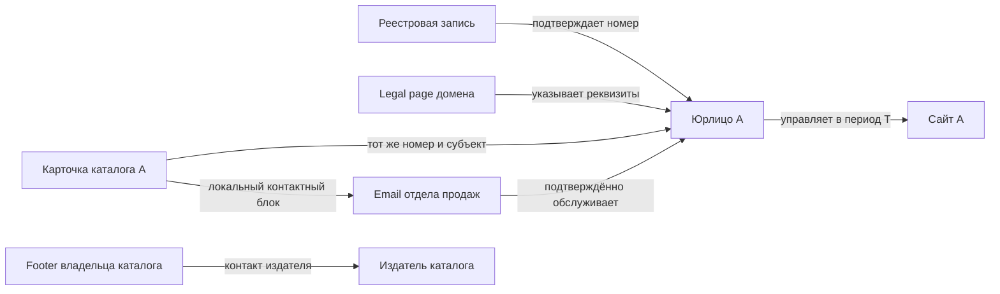

# 2. Идентичность, доказательства и граф связей

## 2.1. Что нужно изменить в модели

Сейчас `CompanyID` в `backend/contexts/lead-management/internal/domain/company.go` равен нормализованному домену. В простом demo это удобно, но юридическая идентичность имеет другую структуру: одна компания имеет несколько доменов, один бренд представляет несколько юрлиц, а сайт каталога содержит тысячи компаний.

Предлагается исследовательский `entity_id` — непрозрачный ID в области tenant. Старый domain-based CompanyID сохраняется как ссылка совместимости. Его миграция не выполняется этим документом и не подменяется массовой заменой первичных ключей.

| Тип | Смысл | Пример идентичности |
|---|---|---|
| `LegalEntity` | Юридическое лицо | Страна + реестр + подтверждённый номер |
| `SoleTrader` | Предприниматель, с отдельной политикой данных | Локальный тип регистрации, не смешанный с юрлицом |
| `Brand` | Торговое имя | Имя + подтверждённые отношения с организациями |
| `Branch` / `Establishment` | Филиал/площадка/офис | Ссылка на организацию + локальный идентификатор |
| `Website` | Домен/сайт в определённый период | Host/eTLD+1, URL scopes, языковые версии |
| `ContactEndpoint` | Email, телефон, форма, business profile | Нормализованное значение и канал |
| `ProfessionalRole` | Публичная профессиональная роль | Организация + роль + период; человек опционален |
| `SourceDocument` | Конкретная версия источника | Artifact ID + hash + observed_at |
| `Assertion` | Утверждение источника/проверки | Субъект + отношение + объект + свидетельство |
| `IdentityDecision` | Решение о тождестве | Участники, версии, основание, автор и статус |

Контакт может обслуживать несколько организаций. Общая АТС или общий email группы представляются отношениями многие-ко-многим, а не поводом объединить организации.

## 2.2. Идентификаторы разных стран

Ключ идентификатора: `(tenant_id, jurisdiction, registry, identifier_type, normalized_value)`. Уникальность зависит от семантики конкретного типа и периода. Для номера, не являющегося уникальным юрлицу, нужен другой тип связи.

| Рынок | Признаки для исследования | Существенное различие |
|---|---|---|
| RU | ИНН, ОГРН/ОГРНИП, КПП | ИНН организации/ИП различаются; КПП характеризует постановку на учёт, не отдельное юрлицо |
| GB | Companies House company number | Сохраняются ведущие нули и буквенные префиксы; VAT — отдельный идентификатор |
| DE | Handelsregister number + register type + court, VAT ID | HRB/HRA и суд входят в область уникальности; VAT не заменяет весь реестр |
| FR | SIREN, SIRET, VAT | SIREN описывает организацию, SIRET — establishment |
| US | Штат + локальный номер регистрации; другие публичные идентификаторы по доступности | Нет единого открытого аналога ИНН для всех компаний; EIN не предполагается публичным |
| AE | Юрисдикция/эмират/free zone + license number | Номер без зоны выдачи может быть недостаточен |
| Международный | LEI при наличии, локальные registry IDs | Многие реальные SME не имеют LEI; отсутствие не означает отсутствия компании |

Это набор проектных профилей, а не утверждение о готовых интеграциях. Доступность данных, лицензии, квоты, способы проверки и значения статусов подтверждаются для каждого конкретного адаптера.

Контрольная сумма, запись реестра и принадлежность номера субъекту имеют отдельные статусы. Нельзя называть компанию проверенной только после локальной арифметической проверки номера.

## 2.3. Типы отношений

Минимальный словарь:

- `has_registration_id`, `has_legal_name`, `has_trade_name`;
- `operates_brand`, `has_branch`, `subsidiary_of`, `represents`;
- `operates_website`, `historically_operated_website`, `redirects_to`;
- `publishes_contact`, `contact_serves_entity`, `contact_has_role`;
- `registered_in`, `has_establishment_in`, `serves_market`;
- `mentions_entity`, `asserts`, `supports`, `contradicts`, `derived_from`;
- `same_entity_as`, `different_entity_from` как версии решений, не свободные предположения модели.

`mentions_entity` — наблюдаемое упоминание. `operates_website` — предметная связь с отдельным основанием. Слова «дилер», «партнёр», «подрядчик», «дочерняя компания» тоже обозначают разные отношения. Нельзя переводить их все в «та же компания».

## 2.4. Анатомия свидетельства

Предлагаемый формат, не текущий API:

```json
{
  "evidence_id": "ev-fixture-1",
  "tenant_id": "tenant-fixture",
  "artifact_id": "artifact-fixture-7",
  "requested_url": "https://directory.example/company/a",
  "final_url": "https://directory.example/company/a",
  "content_sha256": "<sha256-of-captured-representation>",
  "observed_at": "<timestamp>",
  "source_kind": "business_directory",
  "source_subject": "entity-fixture-a",
  "publisher_entity_ref": "entity-fixture-directory-owner",
  "locator": {
    "representation": "html",
    "selector": "article.company-card .contacts",
    "text_start": 1500,
    "text_end": 1660
  },
  "quote": "<контакт и регистрационный номер в одной карточке субъекта>",
  "extractor_version": "contact-parser-v2",
  "acquisition_profile_ref": "acq-profile-fixture"
}
```

Offsets должны относиться к конкретному сохранённому представлению и версии нормализации. Для PDF нужны номер страницы и координаты/текстовый span; для OCR — координаты изображения, инструмент и уверенность распознавания. Одного URL недостаточно: его содержимое меняется.

Hash доказывает неизменность нашего сохранённого содержимого относительно записи. Он не доказывает истинность исходного сайта. TLS/домен, время и способ получения фиксируются отдельно.

Следует хранить оригинальное написание и нормализованное значение. OCR `О/0`, `l/1`, пробелы в телефоне и ID с ведущими нулями требуют воспроизводимого преобразования, а не безусловной потери символов.

## 2.5. Утверждения и их состояния

```json
{
  "assertion_id": "as-fixture-12",
  "subject_ref": "entity-fixture-a",
  "predicate": "contact_serves_entity",
  "object_ref": "contact-fixture-sales",
  "evidence_refs": ["ev-fixture-1", "ev-fixture-2"],
  "status": "supported",
  "observed_at": "<timestamp>",
  "valid_from": null,
  "valid_to": null,
  "recorded_at": "<timestamp>",
  "review_after": "<timestamp>",
  "decision_policy_version": "identity-policy-fixture",
  "supersedes": null
}
```

Состояния: `observed`, `hypothesized`, `supported`, `confirmed_by_policy`, `human_confirmed`, `disputed`, `refuted`, `stale`, `unavailable_for_use`.

`observed_at` — когда мы увидели источник. `valid_from/valid_to` — когда отношение известно как действительное. `recorded_at` — когда система узнала факт. Если источник не указывает начало действия, поле остаётся неизвестным; время загрузки не подставляется как дата начала юридического отношения.

При исправлении сохраняется новая версия утверждения. Удаление/ограничение raw-данных подчиняется правилам обработки: «история» не разрешает бессрочно хранить отозванные персональные данные. Можно оставить разрешённую обезличенную запись об отзыве и зависимостях.

## 2.6. Подтверждение принадлежности контакта

Сначала извлекается субъект фрагмента, затем контакт. Для каталога полезен разбор карточек/строк, для PDF — разделов, для legal page — издателя и представляемой организации.

Рабочая процедура:

1. Найти контактный блок и его границы.
2. Определить субъект блока по локальным полям и заголовку.
3. Проверить регистрационный номер или другой достаточный набор признаков субъекта.
4. Отдельно найти издателя, общесайтовые контакты, автора и рекламные блоки.
5. Связать endpoint с субъектом только в пределах подтверждённого контекста.
6. Проверить актуальность и роль: sales, procurement, support, общая связь, филиал.
7. Проверить противоречащие свидетельства и состояние suppression.

Контакт с внешним доменом может быть легитимным: подрядчик, общий сервис группы, бесплатная деловая почта. Он требует подтверждения связи; автоматический отказ по несовпадению домена потеряет реальные контакты. Доменное совпадение тоже не заменяет проверку локального субъекта.

Общий номер каталога, авторский email статьи, контакты веб-студии, служба поддержки площадки и реквизиты оператора персональных данных должны выделяться отдельно. Это обязательные отрицательные примеры для тестового корпуса.

## 2.7. Установление тождества

Практика record linkage из Splink полезна для ранжирования пар, особенно при отсутствии уникального ID ([S07–S08](08-research.md#s07)). Предлагаемый порядок:

1. **Blocking:** собрать небольшие множества кандидатов по точным ключам, нормализованным именам и регионам. Не сравнивать каждую запись с каждой.
2. **Exact checks:** сопоставить подтверждённые идентификаторы в их юрисдикции и семантике.
3. **Features:** название/alias, адрес, сайт, роль источника, период, отрасль, языковые варианты, независимость подтверждений.
4. **Contradictions:** несовместимые сильные ID, другая организация в той же группе, иная юрисдикция или временной конфликт.
5. **Decision:** автоматическое подтверждение по строгому правилу, дальнейшее исследование, человеческий review либо раздельное хранение.
6. **Audit:** сохранить версию правил, входные assertion IDs, объяснение и возможность обратного решения.

Утверждение LLM «уверенность 0.97» не является калиброванной вероятностью. До оценки на размеченных парах можно применять уровни доказательности (`strong`, `corroborated`, `tentative`, `conflicted`), не обещая статистическую точность.

Для автосвязывания нужна высокая precision; recall можно улучшать дополнительными запросами. Цена ложного слияния включает неправильное письмо реальному адресату, поэтому она существенно выше цены ещё одного поиска.

## 2.8. Независимость и вес источников

У источника хранится профиль: издатель, первоисточник/агрегатор, время, охват, тип данных и известные ограничения. Универсального рейтинга «этому сайту верим во всём» нет: официальный реестр силён в юридических реквизитах, официальный сайт — в текущих каналах связи, каталог — в discovery.

Несколько зеркал одного dataset составляют одну семью происхождения. Copy-paste одинакового описания, общий поставщик и даты помогают обнаруживать зависимость, но сами тоже являются гипотезами до проверки.

Конфликтующая информация не стирается. Система может одновременно знать действующий legal name, исторический бренд и контакт неопределённой актуальности. Контакт выбирается для действия по явной политике с учётом этих различий.

## 2.9. Граф и транзитивность



Цепочка не даёт больше уверенности, чем её существенное слабое звено. Каждое ребро имеет тип, время и основание. Наличие пути в графе не разрешает произвольный вывод: `subsidiary_of` не транзитивно превращается в `same_entity_as`, а общий контакт не означает общее юрлицо.

## 2.10. Изменение идентичности и совместимость

Первый этап хранит исследовательские сущности рядом с существующими lead profiles через явную mapping-таблицу. Исторические request refs, email recipients, версии материалов и approved actions не переписываются.

Ошибочное объединение отменяется новым `IdentityDecision`; исходные entity IDs и evidence сохраняются. Производные индексы и оценки инвалидируются по зависимостям. История уже отправленного сообщения продолжает ссылаться на фактически выбранный тогда снимок и адресат.

Массовая миграция domain-based CompanyID допустима только после отдельного плана контрактной совместимости, dual read, восстановления, проверки outbox и отката. Она не является скрытой частью замены краулера.

## 2.11. Правила принятия результата

Проектный профиль `evidence-policy-v1` описывает переходы явно. Число независимых источников зависит от проверяемого отношения: один надлежащий реестровый ответ может подтвердить номер, а два скопированных каталога не подтверждают контакт. Самооценка LLM не является условием допуска.

| Проверка | Автоматически принять по правилу | Продолжить исследование / review | Не использовать данное основание |
|---|---|---|---|
| Регистрационная идентичность | Номер точного типа/реестра относится к нужному субъекту в сохранённом надлежащем ответе | Совпадает имя, но не хватает области номера/даты/юрисдикции | Контрольная сумма без lookup, цифры из URL/счётчика |
| Связь сайта с субъектом | Legal/requisites блок указывает подтверждённый ID и субъект без существенного конфликта | Бренд/адрес похожи, ID не указан; нужны дополнительные факты | Общая аналитика, один redirect, сходный домен |
| Принадлежность контакта | Контакт находится в предметном блоке уже различённого субъекта с locator и допустимым назначением | Контакт общий для группы/подрядчика, роль или субъект неоднозначны | Footer издателя каталога, автор статьи, реклама другой организации |
| Значение email/телефона | Исходные символы и нормализация воспроизводимы, формат проверен в нужном контексте | OCR ambiguity, неизвестный страновой код, неясное назначение цифр | Явная дата/ID/счётчик либо несуществующее в источнике значение |
| Актуальность для действия | Свидетельство пригодно по policy времени/источника и не отозвано | Старое наблюдение, новый конфликт, неизвестный срок | Действующее опровержение/отзыв запрещает использование |
| Готовность к кампании | Владельцы канала/ограничений подтвердили условия конкретного действия | Неизвестный получатель/доставляемость/право использования | Suppression, неверная версия адресата/материала, недопустимый канал |

«Не использовать основание» не означает удалить компанию. Дossier сохраняет допустимое наблюдение и причину отказа; дальнейший поиск может найти корректный источник. Существенное противоречие нельзя компенсировать количеством слабых совпадений.

Если публичный регистрационный ID отсутствует, можно различить делового субъекта по согласованному набору других свидетельств и сохранить legal identity как неполную. Это не даёт права присвоить `registry-confirmed`. Профиль заявки определяет, достаточно ли подтверждённого business identity или требуется реестровое подтверждение; причина ограниченного результата видна пользователю.

### Раздельные измерения качества

| Измерение | Пример значений | Ответственный за смысл |
|---|---|---|
| Идентичность | candidate / distinguished / registry-confirmed / conflicted | lead-management |
| Связь контакта | observed / supported / confirmed / disputed | lead-management |
| Формат значения | valid / invalid / ambiguous | lead-management |
| Достижимость | unchecked / verified-by-method / catch-all / invalid / unknown | Владелец проверки адреса/канала |
| Актуальность | current / stale / revoked | Владелец факта и policy |
| Соответствие офферу | Оценка по версии критериев конкретной заявки | Владельцы request assessment/audience |
| Допуск действия | eligible / pending / blocked с причинами | outreach-orchestration с policy владельцев |

Это семантика будущих проекций, не новые текущие enum в коде. Один общий статус «валидирован» не заменяет измерения. В UI можно показать: «Компания различена; email принадлежит ей; доставляемость не проверена; письмо ещё не разрешено».

### Проверка цепочки

Для `registry → entity → directory-card → contact` отдельно подтверждаются: идентичность субъекта, отношение карточки к нему и расположение контакта внутри карточки. Не нужно обязательно добавлять ребро `owns_website`, если контакт доказан через другой источник. Проверка не должна выдумывать отсутствующий сайт ради прохождения workflow.

Пример опасной цепочки: статья упоминает компанию A → в footer есть email площадки B. Здесь есть `mentions(A)` и `publisher-contact(B)`, но нет `contact-serves(A)`. Модель обязана вернуть пробел, а исполнитель не имеет правила для такого переноса.

## 2.12. Что именно считается одним лидом

До запуска версия поручения фиксирует `target_unit`:

- `company`: различённый субъект и критерии идентичности/аудитории этой заявки.
- `company-with-contact`: та же компания плюс принадлежащий ей пригодный канал из выбранных типов.
- `email-ready-company`: компания плюс хотя бы один подтверждённый email-адресат, проходящий заданные проверки готовности. Операторское утверждение отправки остаётся отдельным шагом.

**Предложение ассистента для старта**, не ответ пользователя: пилот `company-with-contact` и отдельные проверки RU/GB. Фактическую единицу/страны выбирает человек в поручении; международная программа этим пилотом не ограничивается. Другие единицы заложены в контракт и включаются только с собственными критериями приёмки. Смена единицы или критериев не происходит решением LLM в середине поиска.

Два сайта одного юрлица и три его email не дают три компании. Филиал считается отдельно только при явно выбранной единице и политике филиалов. Ключ засчитывания включает tenant, миссию, версию критериев, единицу результата и canonical entity ref; повтор result receipt не увеличивает число.

Зачёт возможен после устойчивого сохранения dossier, evidence и результата проверки. Техническое «извлечено 17 значений» не равно «сохранено 17 лидов». Ошибка сохранения отображается отдельно, а результат не засчитывается заранее.

Если до завершения миссии два засчитанных кандидата оказались одной компанией или основание отозвано, текущий зачёт пересчитывается с объясняющим событием. При цели 25 появляется дефицит. После завершения сохраняется снимок результата на тот момент; новая проверка показывает текущую актуальность отдельно и не переписывает историю как будто исходного результата не было.

Одновременные workers могут найти больше цели. Подтверждённые дополнительные сущности сохраняются с происхождением; одна транзакционная операция определяет membership целевой выборки и остаток. Полезная дополнительная находка не должна теряться, а уже оплаченный вызов — исчезать из учёта только потому, что другой worker первым заполнил последнее место.
