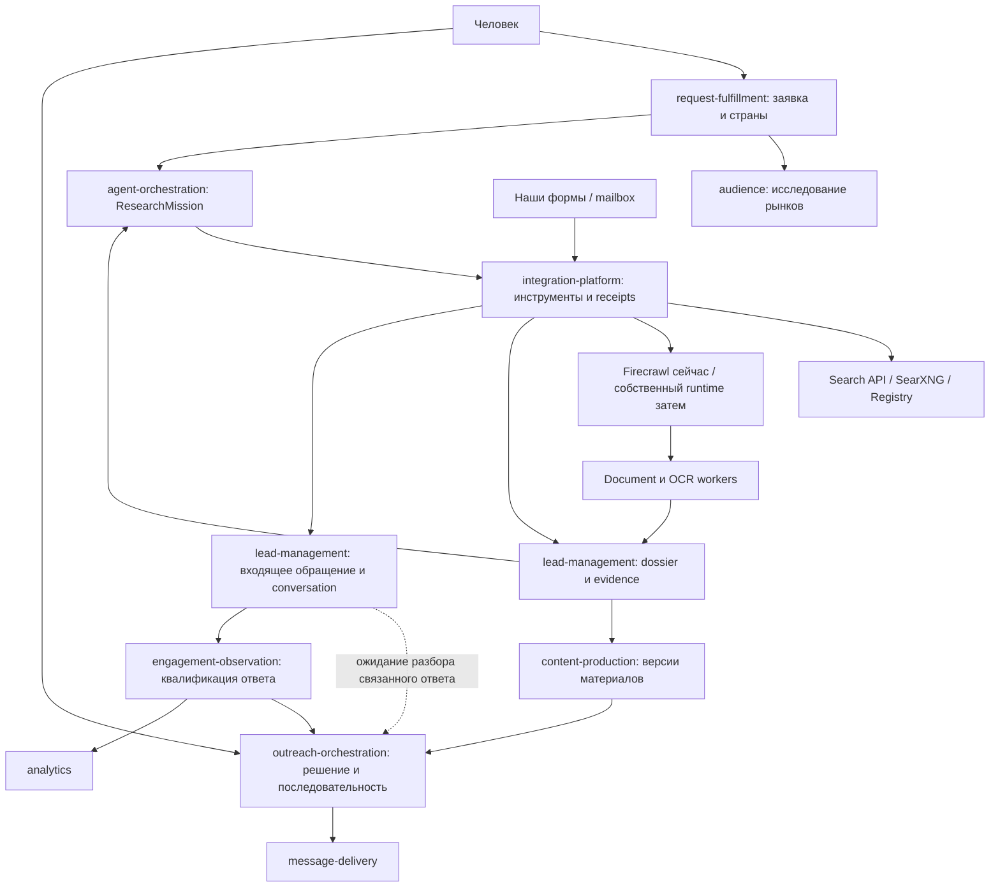

# 7. Архитектура, этапы и проверка результата

## 7.1. От чего отталкиваемся

Исходная ревизия `8977438`. Ниже наблюдения по репозиторию и будущие изменения; это не отчёт о выполненной реализации.

| Наблюдается | Путь | Следствие для концепции |
|---|---|---|
| CompanyID нормализуется из домена | `backend/contexts/lead-management/internal/domain/company.go` | Ввести отдельную исследовательскую entity identity и mapping; не менять PK незаметно |
| Search job использует фиксированный сценарий и текущие правила качества | `backend/contexts/lead-management/internal/app/search_leads.go`, `contact_quality.go` | Новый research path с отдельной версией правил; работающий demo сохраняется |
| Provenance хранит URL/время/метод и optional evidence | `backend/contexts/lead-management/internal/domain/provenance.go` | Нужны версионированные artifacts, субъект, locators и lineage |
| Crawl port возвращает Markdown/metadata; search — text/maxResults | `contracts/integration-platform/crawl/crawl.go`, `search/search.go` | Старые wrappers объявляют ограничения; новые versioned contracts дают capabilities и receipts |
| Есть реестр agent blocks и версии pipeline | `backend/contexts/agent-orchestration/internal/domain/block.go` | LLM-планировщик работает внутри зарегистрированного блока, не заменяет оркестратор |
| Search block возвращает первую найденную компанию | `backend/contexts/agent-orchestration/internal/adapters/blocks/search.go` | Нужна bulk research mission до известной компании и коллекция результатов |
| Исполнение блока вызывается внутри UoW | `backend/contexts/agent-orchestration/internal/app/command/run_step.go` | В новом пути вынести долгий/платный внешний эффект из DB transaction; intent/activity/result |
| Есть точная версия решения и непрозрачные refs | `openspec/specs/outreach-approval/spec.md` | Переиспользовать, не вводить упрощённый send API |
| Engagement квалифицирует/dedup события без пикселей | `backend/contexts/engagement-observation/README.md` | Добавить транспорт почты, корреляцию и смысл ответа; не выдавать events endpoint за готовый mailbox |
| Form submission пересылает PII в контур клиента | `contracts/outreach-orchestration/formsubmission/formsubmission.go` | Сохранить green/red границу; body/MIME хранить у клиента |
| Ранее выбран Crawl4AI, adapter не найден, задачи открыты | `docs/crawl4ai-playbook.md`, `openspec/changes/self-hosted-crawler/` | Сравнить с Crawlee Python по новому разрешению пользователя; не объявлять существующий self-hosted сервис |

## 7.2. Предлагаемая схема

Это границы моделей, а не обязательное число процессов. Existing Go contexts, PostgreSQL, Temporal, брокер и object storage переиспользуются; Python acquisition/document workers подключаются через versioned ports. Raw artifacts с контактами и входящая переписка сохраняются в клиентском red scope, не общедоступной инфраструктурной базе.

## 7.3. Предлагаемая регистрация в domain catalog

**Матрица будущего изменения агрегатов и связей.** Сейчас канонический каталог регистрирует только primary owners семи новых capability; `docs/domain-model.md` и bounded-context-map помечают их как план. При apply запись каждой реально вводимой части должна появиться в `architecture/domain-catalog.yaml`, `docs/domain-model.md` и соответствующей диаграмме в том же change. Нельзя только написать код новой сущности и отложить владение.

| Owning context | Capability/aggregate root | Entities / value objects | Предлагаемые domain events |
|---|---|---|---|
| lead-management | `lead-entity-resolution` / `research-entity` | entity, jurisdictional-id, alias, typed-relation, entity-version | `research-entity-established`, `entity-assertion-recorded` |
| lead-management | `lead-research-memory` / `evidence-document` | document revision, locator, artifact-ref, observation time, purpose-scope | `evidence-recorded`, `evidence-invalidated` |
| lead-management | `lead-entity-resolution` / `identity-decision` | participants, policy-version, decision-revision, contradiction-ref | `identity-link-confirmed`, `identity-link-reverted` |
| agent-orchestration | `adaptive-lead-research` / `research-mission` | mission, research-action, target-unit, budget-reservation-ref, stop-reason | `research-mission-started`, `research-action-completed`, `research-mission-paused`, `research-mission-completed` |
| audience | `international-market-discovery` / `market-study` | study, country-recommendation, demand-hypothesis, evidence-ref | `market-study-completed` |
| request-fulfillment | расширение существующего `request` | market-selection, quota-policy, request-version, approved-budget-ref | Использовать текущий lifecycle; новые события только при необходимости проекций |
| integration-platform | `regional-web-acquisition` / существующий `adapter-registration`, `integration-invocation` | capability-manifest, acquisition-profile, geography-receipt, session-ref, cursor-ref | Технический outcome invocation, не «компания подтверждена» |
| outreach-orchestration | `research-to-outreach` / существующий `campaign` | handoff-ref, recipient-version-ref, material-version-ref, sender-profile-ref | Существующие approval/outcome события; `research-handoff-accepted` при необходимости |
| lead-management | `inbound-lead-conversations` / `lead-inquiry` | inquiry, source-receipt-ref, origin, routing/disposition | `lead-inquiry-recorded`, `inbound-lead-linked` |
| lead-management | `inbound-lead-conversations` / `conversation` | message-ref, participant-ref, correlation-decision, intent-version | `conversation-message-recorded`, `conversation-link-corrected` |
| engagement-observation | расширение существующего `engagement` | qualified-reply-kind, confidence, message-ref без body | Существующее `engagement-observed` с versioned payload |

`research-entity` владеет утверждениями и предметными контактными отношениями; `evidence-document` — неизменяемым свидетельством. `identity-decision` фиксирует решение, а materialized canonical projection строится с CAS по версиям участников и возможностью обратного построения. Нельзя держать весь tenant graph одним блокирующим агрегатом.

Инфраструктурные adapters не владеют значением корпоративных фактов. `audience` владеет оценкой в контексте конкретного оффера; такая оценка не становится универсальной истиной компании. История действий/резервы принадлежат оркестратору, facts/evidence — `lead-management`.

## 7.4. Предлагаемые контракты

Имена и состав предварительные, размещаются у владельца под `contracts/<context>/...`; потребитель не импортирует чужой domain.

| Владелец → потребитель | Контракт | Смысл |
|---|---|---|
| request-fulfillment → agent-orchestration | `research-mission-command` | Снимок человеческого поручения, выбранные рынки/квоты, бюджет, correlation |
| audience → request-fulfillment | `market-study-result` | Рекомендации с источниками, неизвестностями и стоимостью исследования |
| integration-platform → agent-orchestration/lead-management | `regional-search`, `web-acquisition`, `registry-lookup` | Версионированные вызовы; фактические capabilities, cost/geo receipts, bounded artifact refs |
| integration-platform → lead-management | `document-observation` | Технический document/OCR результат с координатами и engine/model version; без решения о принадлежности компании |
| lead-management → agent-orchestration | `research-dossier`, `research-memory`, `identity-resolution` | Чтение разрешённого контекста, запись наблюдений, предложения/решения связей |
| lead-management → outreach-orchestration | `research-handoff` | Снимок готовности контакта и фактов; без скрытой отправки |
| integration-platform → lead-management | `inbound-message-receipt` | Нормализованный transport receipt + red artifact ref; стабильная dedup identity |
| lead-management → engagement-observation / outreach-orchestration | `conversation-signal` | Устойчивое сообщение, результат корреляции и состояние ожидания qualification через scope-safe refs; outreach применяет pending hold, engagement квалифицирует отдельно |
| engagement-observation → outreach-orchestration | существующий `engagement-event` | Остановить/поставить на паузу/предложить следующий шаг по правилам владельца |

Existing `approved-action`, `content-version`, `delivery-target` и действующие владельцы адреса/материала сохраняются. Form relay и outbound form task получают однозначное направление/имя без несовместимого изменения текущего `form-submission`.

Устойчивый `conversation-signal` с подтверждённой корреляцией позволяет временно удержать связанную sequence до глубокой классификации. Это контрольный сигнал, а не `engagement-event` с выдуманным human reply. Квалифицированное событие по-прежнему публикует только `engagement-observation`; причины hold и результат qualification различимы. Прямая подписка outreach и её published contract регистрируются при соответствующем apply вместе с каталогом/диаграммами.

Схема каждого контракта включает tenant/purpose, request/action IDs, версии, deadlines, пределы и различимые outcomes. Payload события не содержит полного dossier, email body или proxy credentials. Разрешение artifact refs проверяет область доступа повторно, а не доверяет одному факту наличия ссылки.

## 7.5. Хранение и retrieval

Первый вариант: PostgreSQL relational keys/constraints, assertion и relation tables, JSONB для технических payload, FTS для текстов, существующий pgvector port для semantic recall. Индексы и summaries — производные представления, не новая база истины.

Предлагаемые логические записи: entity/alias/identifier, source_document/revision, evidence_locator, assertion/history, identity_decision, research_mission/action/result, memory_episode/negative_result, market_study/recommendation, inbound_receipt/inquiry/conversation/message_ref. Это не готовый SQL schema.

Raw HTML/PDF/images/MIME — object storage в клиентском scope с content hash и retention. Таблицы хранят refs/нужные offsets. Отдельные customer buckets/keys и tenant-filtered metadata исключают доступ по угадываемому hash. Cross-tenant dedup не должен позволять проверять наличие чужого документа или открывать чужие bytes.

Graph queries сначала ограничены типами рёбер, tenant, временем и max hops. Graphiti/GraphRAG полезны как идеи временного графа и обзорного retrieval, но внедрение Neo4j/второго workflow engine не требуется для первого среза. При росте индекс оценивается на OpenSearch; отдельная graph DB выбирается только после воспроизводимого performance/expressiveness gap.

## 7.6. Долговечность и платные эффекты

В новом пути три стадии вместо удержания DB transaction во время сети:

1. Короткая транзакция: проверить scope/budget/revision, создать `action-intent`, резерв стоимости, outbox/lease.
2. Activity: выполнить внешний вызов с устойчивым action ID вне транзакции. Учесть ограничения idempotency самого провайдера.
3. Короткая транзакция: CAS по ожидаемой версии, зафиксировать receipt/result/cost, обновить проекции и outbox. Повтор receipt не создаёт новую сущность/письмо.

Crash после оплаченного вызова, но до commit может оставить неопределённый outcome. Если provider поддерживает job lookup/idempotency, результат восстанавливается; иначе политика явно различает reconciliation, ограниченный повтор с возможной второй оплатой и остановку. Temporal replay сам по себе не делает внешние запросы бесплатными или exactly-once.

Workflow содержит детерминированные переходы. LLM/browser/OCR/network — activities с версиями inputs/results. Новая версия prompt/model не меняет уже записанную историю replay. Cancellation/lease timeout прекращают дальнейшее планирование и отменяют поддерживаемые jobs; уже совершённый эффект не объявляется отменённым задним числом.

## 7.7. Этапы, которые можно внедрять отдельно

| Этап | Результат пользователя | Основные зависимости | Условие выхода |
|---|---|---|---|
| P0. Контракты/корпус | Зафиксированы определения результата и метод оценки | Владение, scope, catalog delta при apply, размеченные источники | Каждый тип ошибки имеет наблюдаемый пример и ожидаемый исход |
| P1. Один доказанный контакт | RU/GB seed → юрлицо → сайт/другой источник → принадлежащий контакт → dossier | Evidence, entity IDs, ограниченный planner; Firecrawl допустим | Реальный end-to-end и независимый holdout; ни одной критической ложной связи на acceptance corpus |
| P2. Память и прогресс | Продолжение миссии, история попыток, дефицит, причины ожидания | Durable actions, budget ledger, request projection | После рестарта нет потери результата/слепых повторов; цифры UI раскрываются списками |
| P3. Международное расширение | Страны/квоты, кнопка market study, локальные запросы | Country profiles, source capability registry | Два пилотных рынка проверены отдельно, неподдержанные режимы честно видны |
| P4. Собственное acquisition | Контролируемые HTML/browser/document/OCR, география | Crawlee/Crawl4AI benchmark; recipes; proxy; согласование старых политик | Cutover только принятых source profiles; demo и ссылки совместимы |
| P5. Пакетная цель и материалы | 25 уникальных целевых единиц либо объяснимый partial; видимые письма | Quotas/counting, entity/contact quality, handoff | Нет подмены кандидатов готовыми адресатами; стоимость/дефицит объяснимы |
| P6. Входящие лиды и ответы | Наши формы/mailbox → inbound lead/conversation → учёт намерения | Red intake, mailbox/form bindings, явная ревизия исключения IMAP, dedup | Реальные форма и mailbox, reply correlation, suppression/OOO, tenant isolation |
| P7. Управляемая коммуникация | Точное утверждение, доставка, ручной form task, обратная связь | Sender profile, existing approvals/delivery, P6 приём ответов | Разрешённый тестовый адресат, unknown-send reconciliation, пауза по ответу |
| P8. Вертикальный индекс/масштаб | Пополнение собственного корпуса, recrawl и улучшение ranking | Наблюдаемый спрос/объём, storage/deletion, data freshness | Доказан прирост покрытия/цены, а не только установлен search cluster |

P4 может исследоваться параллельно P1–P3 как отдельный apply-change, но не блокирует исследования поверх Firecrawl. P6 можно делать до batch/market expansion, если приоритет — приём уже приходящих обращений. Автоматическая отправка чужих форм не входит в эту дорожную карту; текущая ручная модель сохраняется.

## 7.8. Бюджет и стоимость

`C_mission = C_search + C_registry + C_egress + C_http + C_browser + C_document/OCR + C_LLM + C_storage + C_operator + C_failures`.

Хранить исходные единицы/валюту, тарифную версию и стоимость с временем. Proxy GB, browser seconds и tokens не складываются без действующего преобразования. Неизвестная цена не равна нулю; для hard limit нужен консервативный резерв либо запрет данного инструмента до тарификации.

Пределы: mission total, time deadline, per-entity attempt cap, per-host rate/concurrency, search calls, fetched pages/bytes, browser actions/seconds, OCR pages/pixels, LLM input/output tokens и число ручных review. Для начала можно предложить 3 query refinements, 10 fetched pages и 2 browser/OCR escalations на один seed, но это **параметры пилота**, не универсальная норма и не гарантия 25 результатов.

Отдельно считать `cost / unique validated entity` и `cost / usable confirmed contact`. Количество скачанных страниц — технический объём, не продуктовая результативность. Бесплатная лицензия crawler не делает бесплатными сеть, proxy, OCR/GPU и сопровождение.

## 7.9. Качество и corpus

Единицы разметки: entity identity, typed relation, source subject, field value, contact-to-entity link, ready recipient, market recommendation, reply correlation и reply intent. Разделить training/recipe-development и holdout по организациям/источникам; копии одной страницы не должны оказаться по обе стороны.

Предлагаемые цели приёмки, **не достигнутые показатели**:

- Ноль обнаруженных критических cross-tenant раскрытий и wrong-entity отправок на acceptance corpus; любое такое событие блокирует cutover.
- Ноль критических false merges/контактов издателя в первом holdout; дополнительно оценивать precision и статистическую неопределённость. Нулевые ошибки на малой выборке не означают нулевой риск.
- Предварительная целевая precision подтверждённых contact links ≥99%; recall и размер выборки публикуются отдельно. Выборка должна быть достаточна для полезного интервала, а не «10 примеров прошли».
- Exact match email/ID/цифр OCR измеряется отдельно от средней текстовой точности; низкая уверенность отправляется на review.
- Корреляция incoming replies не допускает тихого merge при неоднозначности; неправильная связь измеряется отдельно от intent accuracy.
- Стоимость, latency и ручные минуты публикуются по странам/источникам и провалам; общая средняя не скрывает непригодный рынок.

Обязательные примеры корпуса:

1. ИНН → название → сайт → внешний каталог с тем же ИНН → принадлежащий контакт.
2. Каталог с телефоном владельца в footer; статья с датами/ID в цифрах; несколько субъектов на странице.
3. Совпадающие названия в разных странах, разные юрлица одного бренда, общая АТС, переименование и смена домена.
4. DE номер без суда, FR SIREN/SIRET, GB leading zeros; компания без общедоступного registry ID.
5. Одна информация скопирована пятью сайтами; конфликтующие независимые источники и устаревший номер.
6. JS reveal, infinite scroll/pagination, PDF без text layer, контакт на image, mixed scripts, OCR О/0 и rn/m.
7. Национальный телефон допустимой длины меньше demo-порога; номер счётчика не телефон.
8. Required geography недоступна, SERP location не совпадает с egress, expired browser session и provider limits.
9. Prompt injection на странице/в письме; ссылка на private network; revoked evidence в vector/summary/crop.
10. Возобновление после crash в каждом платном шаге; неопределённый SMTP outcome и повтор outbox.
11. Россия по умолчанию, multiselect, явный бюджет market study; изменение рекомендаций не меняет утверждённые страны.
12. Inbound retry, reply token/headers, одинаковые subject, duplicate Message-ID, missing headers, IMAP reconnect/UIDVALIDITY.
13. OOO, bounce, interest+unsubscribe, referral и неверная компания в подписи; form intake без организации.
14. Red sink unavailable не приводит к PII archive в green plane; stale approval не разрешает отправку новому endpoint.

## 7.10. Definition of Done и выпуск

Для каждого этапа отдельно: OpenSpec apply/verify, каталог/модель/диаграммы при вводе сущностей, реальные adapters, contract tests, подходящие domain/persistence/integration tests и реальный пользовательский путь. Задачи со внешней интеграцией нельзя закрывать fake или тестовым POST вместо подключения провайдера.

Перед отметкой реализации выполненной нужны `make check`, `go -C tools/archlint run .`, strict validation и требуемые real integration checks согласно `AGENTS.md`. Эта поставка содержит только план; implementation tasks остаются открытыми. Проверка Markdown/OpenSpec не доказывает готовность crawler/OCR/mailbox к production.

Включение — versioned tenant/cohort/source profile; миграции additive. Старый demo читает прежние company refs. Rollback отключает новый route и сохраняет evidence/receipts/history для разбора; он не удаляет входящие письма и не повторяет уже отправленные сообщения. Firecrawl удаляется как постоянная зависимость только после отдельной приёмки собственного контура и согласованного периода наблюдения.

## 7.11. Первый прототип: конкретная граница

Назначение первого прототипа — подтвердить один исследовательский цикл на реальных источниках, затем расширить его до контролируемой цели и входящей переписки. Это уточнение приоритета существующих P0–P8, не новая реализация и не замена их критериев.

| Поставка | Объём | Что показываем | Условие принятия |
|---|---|---|---|
| R1. Доказанный контакт | Один seed за запуск; RU или GB как отдельный country profile; name/registry ID; text/JSON/доступный Markdown | Различённый субъект, contact link, dossier/evidence, понятный исход | Реальный lookup/acquisition и сохранение; invalid/ambiguous данные не засчитаны |
| R2. Управляемая цель | Несколько seed, сначала малый прогон, затем 25; unit company-with-contact; durable queue/budget | Текущий шаг, сохранённые кандидаты, зачёт, дефицит, pause/partial | Нет дублей/потерь при рестарте; каждый счётчик открывает соответствующие записи |
| R3. Обратная связь | Одна наша форма, один рабочий mailbox, один sender profile, controlled outgoing reply | Inbound lead/conversation, цитаты/intent, пауза по ответу | Реальное поступление и ответ; повтор не создаёт дубль, конфликт correlation требует review |
| R4. Расширенное acquisition | Crawlee/Crawl4AI benchmark, browser recipes, document/OCR и geo profiles | Те же dossier и locators на новых классах источников | Прирост правильных результатов/стоимости измерен, путь совместим с R1–R3 |

R1 работает на существующем Firecrawl через совместимую обёртку. Raw DOM нельзя объявить полученным, если adapter вернул только Markdown: сохраняется именно это представление с hash/offset/нормализатором и честным capability receipt. Registry JSON и его field paths могут быть отдельными evidence. Страница с контактом только в изображении до R4 даёт понятный unsupported/review, а не фиктивное чтение OCR.

RU/GB профили не предполагаются готовыми по одному справочнику: для каждого обязательна реальная проверка источника и доступа. Известный реестровый ID делает первый путь проверяемым; отсутствие публичного ID остаётся видимым пробелом/ручным случаем, не причиной выдумывать номер или терять обращение.

Оператор запускает R1 в области человеческого поручения. Новый research path имеет отдельную версию и не стартует одновременно с legacy demo по одному execution intent. Миссия публикует результат/прогресс; финальный переход клиентской заявки остаётся у `request-fulfillment`. До отдельной проводки terminal fulfillment R1 не завершает всю заявку самостоятельно.

## 7.12. Минимальный состав запуска

Использовать существующие Go contexts, PostgreSQL, Temporal и object storage; выбирать только реально используемые роли топологии. Для R1 нужны рабочие source/acquisition access и text/structured модель, если подключается LLM. Embeddings не обязательны: exact/alias/FTS и корректные свидетельства полезнее неработающей vector memory.

Кандидатная граница процессов:

- Существующая HTTP-поверхность оператора и read models владельцев.
- Один research worker на Temporal task queue с bounded concurrency.
- Существующие persistence/outbox/инфраструктурные роли, нужные этому пути.
- Firecrawl adapter сейчас; один собственный acquisition worker появляется только в R4.
- Document/OCR worker запускается при наличии принятого профиля и ресурса; не загружается в каждый Go API process.
- Один mailbox connector и red intake для R3; свой полноценный mail server в этот срез не входит.

Это проект deployment-состава, не готовый новый Compose. Точные task queue/endpoint/env names фиксируются при apply вместе с runbook. Текущие контейнеры не перестраиваются ради этой документации.

## 7.13. Обязательные данные и переходы прототипа

| Владелец / существующий предложенный AR | Минимальное дополнение внутри модели | Инвариант |
|---|---|---|
| agent-orchestration / research-mission | CriteriaSnapshot, Action, ResultMembership, CompletionSnapshot | Один membership на canonical entity/target unit/criteria version; финальный снимок воспроизводим |
| lead-management / research-entity | Identifiers, typed relations, quality dimensions | Не путать неполную legal identity с реестровым подтверждением |
| lead-management / evidence-document | Представление, hash, subject scope, locator, normalization version | Значение восстановимо в том представлении, которое реально получено |
| lead-management / identity-decision | Основание, participant versions, supersession | Merge/unmerge приводит к наблюдаемому пересчёту зависимых результатов |
| lead-management / lead-inquiry, conversation | ReceiptRef, origin, correlation decision, new-body quotes, intent version | Повтор не создаёт новый лид; thread conflict не разрешается сходством темы |
| outreach-orchestration / campaign | Pending-reply hold, eligibility revision, sender profile refs | Не начатый follow-up не продолжается после применимого ответа/отказа |

Названия внутренних частей проектные, не готовые типы/таблицы. Нужные новые сущности/VO/policies и контракты регистрируются при apply в том же каталоге владельца. Отдельного универсального `AI brain` aggregate или общей бизнес-базы integration-platform не вводится.

Проекция прогресса хранит `mission_ref`, `criteria_version`, `projection_revision`, target unit/target, сохранённые candidate refs, различённые subject refs, credit membership, current phase/question, heartbeat time, last meaningful result time, waiting reason, completion outcome и next eligible attempt time. Транспорт UI может быть polling/SSE; оба должны читать одну авторитетную проекцию, а не складывать клиентские callbacks.

При gap/reconnect UI загружает snapshot с revision и затем последующие события. Дубли/порядок доставки не меняют зачёт. Клиент не уменьшает «осталось» по одному факту прихода нового URL.

## 7.14. Контракт приёмки первой поставки

Каждая строка — отдельный ожидаемый результат, а не обещание одинаковой успешности всех сайтов.

| Проверка | Ожидаемый наблюдаемый исход |
|---|---|
| ID → реестр → сайт → контакт другого источника | Один устойчивый dossier с цепочкой; сайт необязателен, если связь доказана иначе |
| Только похожее имя без сильного основания | Candidate/review с пробелом, без автоматического merge |
| Email footer владельца каталога | Отдельный субъект/отклонённое основание, зачёт не вырос |
| Контакт только на image до OCR capability | Unsupported/review с объяснением; распознанные символы не выдуманы |
| Извлечение успешно, запись результата неуспешна | Видна ошибка persist, сохранённый зачёт не вырос |
| Повтор одного receipt | Та же сущность/результат, без увеличения счётчика |
| Два workers дали разные домены одного субъекта | Один зачёт по выбранной единице |
| После merge подтверждены дубли | Наблюдаемый пересчёт и дефицит до закрытия; доказательства/стоимость сохранены |
| Deadline/budget при частичном результате | Completed/partial с сохранёнными объектами и stop reason |
| Живой worker давно не дал результата | Различимые heartbeat и last meaningful result, отсутствие выдуманного ETA |

Для R2 добавляются concurrent last slot, terminal/in-flight race, resume без расширения бюджета и восстановление UI snapshot. Для R3 — реальный form/mailbox intake, conflicting reply refs, отсутствие компании, OOO/отписка/вопрос, classification timeout и три исхода reply/send race из документа 10.

Перед R4 источник/формат/география входят в capability manifest только после собственного acceptance. Fixture tests обязательны для ошибок, но live source/mailbox путь не закрывается fixture или тестовым endpoint без фактического подключения.

## 7.15. Порядок дальнейшей реализации

Рекомендуемый старт: R1 evidence/entity/contact → R2 durable counts/progress → R3 inbound loop. Исследование собственного acquisition R4 можно вести независимо с тем же контрактом; Firecrawl даёт возможность проверить предметную логику до замены движка. Полная MarketStudy, новые страны, сложный ranking и массовая эксплуатация развиваются после качества основного цикла.

Каждую поставку удобнее оформлять малым apply-change, ссылающимся на нужные требования этой концепции. Требования концепции и её незавершённые задачи при этом не объявляются реализованными автоматически. Перенос задачи имеет явную ссылку и критерий, чтобы не получить два несогласованных плана и два параллельных запуска одной заявки.
