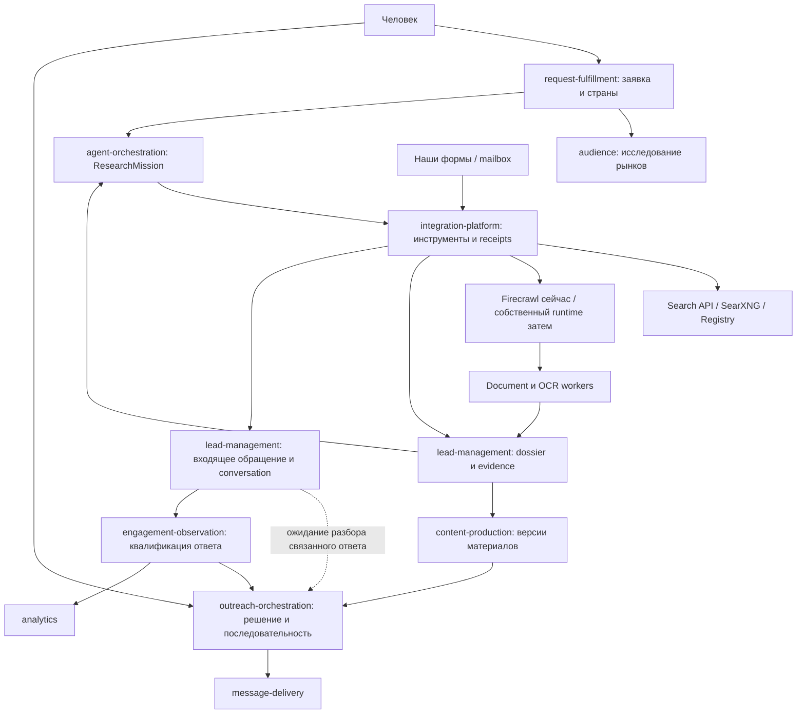

# 7. Архитектура, этапы и проверка результата

## 7.1. От чего отталкиваемся

Исходная концепция опиралась на `8977438`; углублённый аудит выполнен на `bbe49f6`. Ниже отдельно обозначены наблюдения исходного кода и предлагаемая реализация. Наличие кода не означает прохождение живой интеграции. Актуальная последовательность S0–S6 и поисковый цикл — в [документе 11](11-search-implementation-blueprint.md), основания и исправления — в [аудите](12-change-audit.md).

| Наблюдается | Путь | Следствие для концепции |
|---|---|---|
| CompanyID равен нормализованному домену; в legacy `lead_profile` PK глобален по `id` | `backend/contexts/lead-management/internal/domain/company.go` | Ввести scoped entity identity и bridge; проверить два tenant с одинаковым domain до записи legacy projection |
| Search job уже использует LLM Plan/refine и текущие demo quality filters; durable discovery portfolio ещё не реализован | `backend/contexts/lead-management/internal/app/search_leads.go`, `contact_quality.go` | Новый research path с отдельной версией правил; работающий demo сохраняется |
| Provenance хранит URL/время/метод и optional evidence | `backend/contexts/lead-management/internal/domain/provenance.go` | Нужны версионированные artifacts, субъект, locators и lineage |
| Crawl port возвращает Markdown/metadata; search — text/maxResults | `contracts/integration-platform/crawl/crawl.go`, `search/search.go` | Старые wrappers объявляют ограничения; новые versioned contracts дают capabilities и receipts |
| Есть реестр agent blocks и версии pipeline | `backend/contexts/agent-orchestration/internal/domain/block.go` | LLM-планировщик работает внутри зарегистрированного блока, не заменяет оркестратор |
| Search block возвращает первую найденную компанию | `backend/contexts/agent-orchestration/internal/adapters/blocks/search.go` | Нужна bulk research mission до известной компании и коллекция результатов |
| Исполнение блока вызывается внутри UoW | `backend/contexts/agent-orchestration/internal/app/command/run_step.go` | В новом пути вынести долгий/платный внешний эффект из DB transaction; intent/activity/result |
| Есть версия решения и непрозрачные refs; фиксация конкретного recipient требует отдельной проверки | `openspec/specs/outreach-approval/spec.md` | Переиспользовать владельцев; новый handoff фиксирует recipient snapshot, не разрешает mutable lookup первого email компании |
| Engagement квалифицирует/dedup события без пикселей | `backend/contexts/engagement-observation/README.md` | Добавить транспорт почты, корреляцию и смысл ответа; не выдавать events endpoint за готовый mailbox |
| Form submission пересылает PII в контур клиента | `contracts/outreach-orchestration/formsubmission/formsubmission.go` | Сохранить green/red границу; body/MIME хранить у клиента |
| Ранее выбран Crawl4AI, adapter не найден, задачи открыты | `docs/crawl4ai-playbook.md`, `openspec/changes/self-hosted-crawler/` | Сравнить с Crawlee Python по новому разрешению пользователя; не объявлять существующий self-hosted сервис |
| Vector port хранит `double precision[]`, читает весь индекс; tenant/purpose/delete/revision отсутствуют | `contracts/integration-platform/vector/vector.go`, `backend/contexts/integration-platform/internal/adapters/vector/postgres/store.go` | Нужен scoped versioned API; pgvector extension не является существующей реализацией |
| У agent-orchestration только green migrations; lead-management уже принимает green/red pools | `backend/contexts/agent-orchestration/migrations/migrations_test.go`, `backend/contexts/lead-management/adapters.go` | Raw brief/query/context требуют нового red payload repository и клиентского executor |
| Research object-store adapter в обследованных lead/integration/content/cmd путях не найден | Перечень обследованных файлов в [аудите](12-change-audit.md) | Хранение bytes/blob refs проектируется и проверяется явно; существующая готовая интеграция не предполагается |

## 7.2. Предлагаемая схема

Это границы моделей, а не обязательное число процессов. Существующие Go contexts, PostgreSQL, Temporal и брокер задают основу исполнения. Python acquisition/document workers подключаются через versioned contracts. Red payload repositories, artifact storage и клиентский research executor — предлагаемые дополнения, описанные ниже; готовый object-store adapter не заявляется. Raw query, snippets, source artifacts и переписка остаются в клиентском red scope, а общий control plane получает разрешённые metadata и opaque refs.

## 7.3. Предлагаемая регистрация в domain catalog

**Матрица будущего изменения агрегатов и связей.** Сейчас канонический каталог регистрирует только primary owners семи новых capability; `docs/domain-model.md` и bounded-context-map помечают их как план. При apply запись каждой реально вводимой части должна появиться в `architecture/domain-catalog.yaml`, `docs/domain-model.md` и соответствующей диаграмме в том же change. Нельзя только написать код новой сущности и отложить владение.

| Owning context | Capability/aggregate root | Entities / value objects | Предлагаемые domain events |
|---|---|---|---|
| lead-management | `lead-entity-resolution` / `research-entity` | entity, jurisdictional-id, alias, typed-relation, entity-version | `research-entity-established`, `entity-assertion-recorded` |
| lead-management | `lead-research-memory` / `evidence-document` | document revision, locator, artifact-ref, observation time, purpose-scope | `evidence-recorded`, `evidence-invalidated` |
| lead-management | `lead-research-memory` / предлагаемый `open-research-need` | entity-ref, required-relation, criteria/purpose scope, attempt-refs, need-state, dependency revisions | `research-need-recorded`, `research-need-reassessed` |
| lead-management | `lead-entity-resolution` / `identity-decision` | participants, policy-version, decision-revision, contradiction-ref | `identity-link-confirmed`, `identity-link-reverted` |
| agent-orchestration | `adaptive-lead-research` / `research-mission` | mission, SearchBrief, StrategyCell, QueryFamily, research-action, target-unit, firecrawl-grant-ref, stop-reason | `research-mission-started`, `research-action-completed`, `research-mission-paused`, `research-mission-completed` |
| audience | `international-market-discovery` / `market-study` | study, country-recommendation, demand-hypothesis, evidence-ref | `market-study-completed` |
| request-fulfillment | расширение существующего `request` | market-selection, quota-policy, request-version, approved-firecrawl-credit-cap | Использовать текущий lifecycle; новые события только при необходимости проекций |
| integration-platform | `regional-web-acquisition` / существующий `adapter-registration`, `integration-invocation` | capability-manifest, acquisition-profile, geography-receipt, session-ref, cursor-ref, frontier lease, Firecrawl credit grant/receipt | Технический outcome invocation, не «компания подтверждена» |
| outreach-orchestration | `research-to-outreach` / существующий `campaign` | handoff-ref, recipient-version-ref, material-version-ref, sender-profile-ref | Существующие approval/outcome события; `research-handoff-accepted` при необходимости |
| lead-management | `inbound-lead-conversations` / `lead-inquiry` | inquiry, source-receipt-ref, origin, routing/disposition | `lead-inquiry-recorded`, `inbound-lead-linked` |
| lead-management | `inbound-lead-conversations` / `conversation` | message-ref, participant-ref, correlation-decision, intent-version | `conversation-message-recorded`, `conversation-link-corrected` |
| engagement-observation | расширение существующего `engagement` | qualified-reply-kind, confidence, message-ref без body | Существующее `engagement-observed` с versioned payload |

`research-entity` владеет утверждениями и предметными контактными отношениями; `evidence-document` — неизменяемым свидетельством. `identity-decision` фиксирует решение, а materialized canonical projection строится с CAS по версиям участников и возможностью обратного построения. Нельзя держать весь tenant graph одним блокирующим агрегатом.

Инфраструктурные adapters не владеют значением корпоративных фактов. `audience` владеет оценкой в контексте конкретного оффера; такая оценка не становится универсальной истиной компании. История миссии, стратегий и логических попыток принадлежит `agent-orchestration`, facts/evidence — `lead-management`. Денежный ledger, credit admission/reservation и reconciliation существуют только для Firecrawl и принадлежат `integration-platform`; оркестратор хранит grant/receipt refs и не ведёт второй финансовый ledger. Остальные tools используют имеющийся proxy и технические limits без нового денежного gate.

Сеть предметных отношений и индекс зависимостей выводов принадлежат `lead-management`. Новое знание может обновить досье и OpenNeed без внешнего поиска; `agent-orchestration` принимает решение об исполнении только в пределах действующей миссии. Межконтекстное событие содержит разрешённые refs/версии; данные источника и контакты не становятся общим platform storage. Aggregate boundaries и фактически вводимые domain events регистрируются при apply по задаче 1.2.

## 7.4. Предлагаемые контракты

Имена и состав предварительные, размещаются у владельца под `contracts/<context>/...`; потребитель не импортирует чужой domain.

| Владелец → потребитель | Контракт | Смысл |
|---|---|---|
| request-fulfillment → agent-orchestration | `research-mission-command` | Снимок человеческого поручения, выбранные рынки/квоты, Firecrawl credit cap, технические пределы, correlation |
| audience → request-fulfillment | `market-study-result` | Рекомендации с источниками, неизвестностями и usage; кредиты учитываются отдельно только при вызовах Firecrawl |
| integration-platform → agent-orchestration/lead-management | `regional-search`, `web-acquisition`, `registry-lookup` | Версионированные вызовы; фактические capabilities, usage/geo receipts, Firecrawl grant refs при его использовании, bounded artifact refs |
| integration-platform → lead-management | `document-observation` | Технический document/OCR результат с координатами и engine/model version; без решения о принадлежности компании |
| lead-management → agent-orchestration | `research-dossier`, `research-memory`, `identity-resolution` | Чтение разрешённого контекста, запись наблюдений, предложения/решения связей |
| lead-management → outreach-orchestration | `research-handoff` | Снимок готовности контакта и фактов; без скрытой отправки |
| integration-platform → lead-management | `inbound-message-receipt` | Нормализованный transport receipt + red artifact ref; стабильная dedup identity |
| lead-management → engagement-observation / outreach-orchestration | `conversation-signal` | Устойчивое сообщение, результат корреляции и состояние ожидания qualification через scope-safe refs; outreach применяет pending hold, engagement квалифицирует отдельно |
| engagement-observation → outreach-orchestration | существующий `engagement-event` | Остановить/поставить на паузу/предложить следующий шаг по правилам владельца |

Действующие владельцы `approved-action`, `content-version`, `delivery-target` сохраняются. Новый research-handoff требует версии конкретного recipient snapshot: mutable `CompanyID → первый email` не считается фиксацией адресата. Текущая сериализация delivery payload также проверяется отдельно перед повторным использованием red-only reply content; желаемая граница не объявляется фактом legacy. Form relay и outbound form task получают однозначное направление/имя без несовместимого изменения текущего `form-submission`.

Устойчивый `conversation-signal` с подтверждённой корреляцией позволяет временно удержать связанную sequence до глубокой классификации. Это контрольный сигнал, а не `engagement-event` с выдуманным human reply. Квалифицированное событие по-прежнему публикует только `engagement-observation`; причины hold и результат qualification различимы. Прямая подписка outreach и её published contract регистрируются при соответствующем apply вместе с каталогом/диаграммами.

Схема каждого контракта включает tenant/purpose, request/action IDs, версии, deadlines, пределы и различимые outcomes. Payload события не содержит полного dossier, email body или proxy credentials. Разрешение artifact refs проверяет область доступа повторно, а не доверяет одному факту наличия ссылки.

## 7.5. Хранение и retrieval

Первый вариант — отдельные scoped таблицы PostgreSQL у владельцев, relational constraints, assertion/relation tables и lexical/FTS retrieval. Semantic recall добавляется после сравнения качества. Нынешний vector adapter хранит `double precision[]` и перебирает строки без tenant/purpose API; это не готовая research memory и не установленный pgvector. Новый index contract должен поддерживать scope, object/revision, отзыв/удаление и проверку перед выбором кандидатов и при разрешении ссылок. Отсутствие embedding API не блокирует S1/S2.

Предлагаемое физическое размещение:

| Данные / владелец | Где сохраняются | Что допустимо в общем control plane |
|---|---|---|
| SearchBrief, QueryFamily, raw queries, предложения модели и prompt context / agent-orchestration | Новый client red repository `research_payload(tenant_id,payload_id,revision,kind,purpose_id,body_hash,body_json,expires_at)`; PK включает tenant и revision | Approved scope/countries/target, technical limits, policy revision, opaque payload refs |
| Источники, snippets, contact assertions, document revisions/locators / lead-management | Client red schema и новый artifact adapter; для малого bounded среза bytes могут храниться в PostgreSQL `bytea` с жёстким размером, крупные документы — через явно реализованный blob adapter | Разрешённые IDs, hashes, representation/size и версии; содержимое разрешает только владелец |
| Mission/actions/membership / agent-orchestration | Control state с tenant/purpose и refs; чувствительная часть действия — red payload | Статус, causal IDs, grant refs, deadlines и progress revision |
| Frontier/invocation / integration-platform | Один authoritative ledger; URL/query payload в клиентской области, lease/control metadata отдельно | Task ID, epoch, provider job ref, outcome, usage; raw URL с возможными контактами не попадает в общие логи |
| Firecrawl credits / integration-platform | Единственный ledger grant/reservation/receipt для Firecrawl | Ссылки и состояние credit grant; оркестратор не дублирует бухгалтерию |

Это проект новых таблиц и adapters. Существующий pattern раздельных pools виден в `backend/contexts/lead-management/adapters.go:59`, отдельные demo DSN — в `compose.demo.yaml:123`; у agents сейчас только green migrations. Поэтому нужны red migration/DSN binding и клиентская executor роль, а не запись полного LLM context в существующий green JSONB snapshot. Temporal history и outbox передают refs; клиентский executor разрешает их и собирает контекст непосредственно перед вызовом.

Entity key — `(tenant_id, entity_id)`; assertion/evidence/decision keys включают соответствующие версии. Legacy bridge хранит tenant, old key, entity ref и основание решения; неоднозначность сохраняется. Текущий upsert `lead_profile` по глобальному `id` меняет `tenant_id` при конфликте, поэтому его нельзя использовать как безопасный bridge двух tenant без отдельной совместимой миграции/adapter. Старые записи без установленного владельца не присваиваются автоматически.

Raw HTML/PDF/images/MIME сохраняются с hash, размером и retention; content hash не является полномочием доступа. Cross-tenant dedup не должен раскрывать наличие чужих bytes. Производные FTS/vector/summary projections удаляются или инвалидируются вместе с основанием. Graph queries ограничены типами рёбер, scope, временем и max hops. Graphiti/GraphRAG дают идеи временного графа, но graph DB и OpenSearch вводятся только после измеримого пробела текущего варианта.

## 7.6. Долговечность и платные эффекты

Все внешние действия используют `intent + outbox → execution → receipt → apply result`. Денежный grant/reservation нужен только Firecrawl; технический lease для собственного fetch не означает денежного резерва.

1. `agent-orchestration` короткой транзакцией фиксирует logical action ID, input/profile revisions, scope, deadline и outbox. Для Firecrawl действие ссылается на credit grant владельца `integration-platform`; создание и подтверждение grant согласуются идемпотентно отдельными owner-транзакциями, а не общей SQL-транзакцией двух контекстов. Dispatch ждёт действительного grant только на Firecrawl route.
2. `integration-platform` выдаёт lease назначенному invocation/frontier item. Activity получает refs и выполняется вне открытой DB transaction; клиентский executor разрешает red payload, вызывает разрешённый transport через существующий proxy либо Firecrawl adapter и сохраняет artifacts у владельца.
3. Owner-транзакция фиксирует receipt, versions и outbox. Lead-management принимает observation и обновляет entity/evidence/OpenNeed; orchestrator после устойчивого ответа записывает result membership. Повтор сообщения не создаёт дополнительную сущность или зачёт. Firecrawl receipts отдельно согласуют кредиты, прочие receipts — технический usage.

Новый registered research block не должен расширять legacy `RunStep`, который вызывает executor внутри UoW. Он создаёт intent/child-mission ref и возвращает управление; отдельный workflow/activity path продолжает работу. Prompt/model/tool revisions закреплены во входах и receipts. Для старых histories применимы отдельное workflow name либо совместимое version branching и replay test; Temporal SDK проекта — `v1.36.0`.

У `integration-platform` один authoritative frontier: unique `(scope, action_id, target_fingerprint, profile_revision)`, state, `lease_epoch`, expiry, attempt и provider job ref. Python runtime выполняет один bounded task/recipe; его локальные retries укладываются в тот же attempt/time/bytes grant. Отдельный долговечный scheduler/recrawl библиотеки не становится вторым владельцем миссии. Если framework queue необходима, она обслуживает один bounded child job, а discovered URLs возвращаются в authoritative frontier.

После lease expiry сначала проверяется уже запущенный provider job. Fencing epoch не допускает устаревшего изменения control state; поздние receipts всё равно учитываются как полученные artifacts/usage. Crash после Firecrawl effect до commit может оставить неизвестный расход credits; нужен lookup/reconciliation или явный ограниченный повтор в оставшемся cap. Для других tools через proxy unknown outcome также видим, но новый денежный gate не вводится. Stable action ID и Temporal replay не гарантируют exactly-once внешнего сервиса.

Cancellation прекращает дальнейшее планирование и отменяет поддерживаемые jobs. Совершённый эффект не объявляется отменённым задним числом; completed snapshot не меняется от позднего receipt.

## 7.7. Этапы, которые можно внедрять отдельно

Актуальная последовательность — S0–S6 из [§11.18](11-search-implementation-blueprint.md#1118-порядок-реализации). Она учитывает последний приоритет пользователя: искать новые компании и качественно обходить источники. Старая P0–P8/R1–R4 очередность больше не задаёт порядок поставки.

| Этап | Результат | Что проверяем |
|---|---|---|
| S0. Границы и фундамент | Scoped identity/storage, source capabilities, intent/result protocol, durable Firecrawl grant/reservation/receipt и corpus | До первого платного вызова нового пути S1 credit cap уже соблюдается после crash/retry; новый action не создаёт дополнительный cap |
| S1. Discovery из брифа через Firecrawl | SearchBrief, query families, реальные кандидаты и источники в памяти/UI даже без email | Поиск компаний с нуля по критериям человека |
| S2. Прицельный обход и проверенный контакт | Очередь страниц, subject blocks, identity/link checks, OpenNeed и позднее обогащение | Объяснимый контакт нужного субъекта, сохранение неполной компании |
| S3. Адаптивность и добор | Портфель стратегий, ограниченный planner, добор по измеренной отдаче, единая история попыток и прогресс поверх принятого Firecrawl ledger | Выбранное в заявке количество целевых единиц либо честный partial, сопоставление с фиксированным планом |
| S4. Собственный runtime и расширение источников | Принятые HTTP/browser/OCR profiles, проверенная search/proxy geography, cutover/rollback | Измеримый прирост при сохранении рабочего Firecrawl route |
| S5. Материалы и обратная связь | Recipient/material versions, формы, реальный mailbox, conversations | Полный цикл обращения и новые evidence из ответов |
| S6. Расширение рынков и эксплуатационная приёмка | Per-country coverage, MarketStudy/индекс по полному scope, нагрузка и восстановление | Все обязательные функции и сквозная приёмка |

S0 включает минимально долговечный Firecrawl ledger до первого платного нового пути S1; S3 расширяет стратегию добора и измерение отдачи, а не впервые вводит ограничение кредитов. Этапы обозначают проверяемые результаты, зависимости задач имеют приоритет над их порядковыми номерами. Международные типы/scope закладываются в S0/S1; источники и страны принимаются по мере готовности. Исследование собственного runtime можно вести параллельно ранним Firecrawl срезам. S5 не блокирует S1–S4. R1–R4 ниже сохраняют полезные проверочные сценарии, но не являются последовательными релизами.

[Task DAG](task-blueprints.json) задаёт зависимости, владельцев, concrete targets и критерии: 91 исходная задача плюс 4.16–4.18 для SearchBrief/портфеля discovery/его измерений, всего 94. Этапы — рекомендуемая группировка; следующий apply-срез выбирается из готовых по зависимостям задач. Полный scope REQ-01…36 сохраняется.

## 7.8. Бюджет и стоимость

**CL-16: денежный бюджет приложения относится только к Firecrawl.** `integration-platform` владеет одним credit ledger/admission/reservation/reconciliation для Firecrawl Search/Crawl/Extract. `agent-orchestration` хранит approved cap/grant refs, связывает дочерние действия с родительской миссией и не открывает новый cap созданием очередного технического job.

Firecrawl учитывает reserved/used/unknown credits по устойчивому action/invocation ID и фактическим receipts. Unknown после внешнего эффекта не превращается в нулевой расход и не освобождает резерв без основания. Cap не расширяется моделью; resume не создаёт второй бюджет.

Остальные search/LLM/browser/OCR/acquisition инструменты используют существующий proxy. Для них не вводятся дополнительный денежный cap, финансовое резервирование или approval. Измерять время, CPU/RAM, bytes, browser seconds, OCR pages/pixels, tokens, attempts и ручные минуты полезно для выбора реализации; эти показатели не являются вторым финансовым gate. Тариф или внешняя стоимость, если они известны, — аналитическая метрика, а не новое условие разрешения вызова.

Технические пределы: mission deadline, per-entity/strategy attempts, per-host concurrency/rate, pages/bytes, browser actions/time и размер документов. Предложенные числа вроде 3 уточнений запроса, 10 страниц и 2 browser/OCR escalations — параметры испытания, не универсальная норма. Наличие proxy не доказывает региональную выдачу, страну выхода, sticky session или поддержку browser/OCR transport: проверяются конкретные capabilities/receipts.

Показывать полезный результат на Firecrawl credits и на время/технический usage отдельно. Нулевой результат сохраняет потраченные credits и работу в отчёте; «стоимость на результат» при нуле результатов не записывается как ноль.

## 7.9. Качество и corpus

Единицы разметки: entity identity, typed relation, source subject, field value, contact-to-entity link, ready recipient, market recommendation, reply correlation и reply intent. Разделить training/recipe-development и holdout по организациям/источникам; копии одной страницы не должны оказаться по обе стороны.

Три слоя оценки: frozen-artifact extraction/linking; paired live acquisition на одинаковых источниках, технических лимитах и Firecrawl cap; end-to-end missions с учётом нулевых результатов и недобора. При сравнении crawler используется одинаковое downstream извлечение; отдельно сравниваются fixed/deterministic и bounded LLM стратегии.

120 объектов из документа 9 — стартовый smoke/инструментальный корпус, а не достаточная статистическая гарантия. Документы не равны независимым contact-link decisions. При 120 независимых правильных решениях и нуле ошибок точная односторонняя 95% нижняя граница precision — около 97,53%; для границы 99% требуется минимум 299 независимых all-correct решений. Повторы организации/шаблона/source family нарушают независимость, поэтому размер и метод выборки, интервалы и страны публикуются отдельно. Development corpus отделён от скрытого holdout.

Предлагаемые цели приёмки, **не достигнутые показатели**:

- Ноль обнаруженных критических cross-tenant раскрытий и wrong-entity отправок на acceptance corpus; любое такое событие блокирует cutover.
- Ноль критических false merges/контактов издателя в первом holdout; дополнительно оценивать precision и статистическую неопределённость. Нулевые ошибки на малой выборке не означают нулевой риск.
- Предварительная целевая precision подтверждённых contact links ≥99%; recall и размер выборки публикуются отдельно. Выборка должна быть достаточна для полезного интервала, а не «10 примеров прошли».
- Exact match email/ID/цифр OCR измеряется отдельно от средней текстовой точности; низкая уверенность отправляется на review.
- Корреляция incoming replies не допускает тихого merge при неоднозначности; неправильная связь измеряется отдельно от intent accuracy.
- Стоимость, latency и ручные минуты публикуются по странам/источникам и провалам; общая средняя не скрывает непригодный рынок.

Обязательные примеры корпуса:

1. ИНН → название → сайт → внешний каталог с тем же ИНН → принадлежащий контакт.
2. Каталог с телефоном владельца в footer; статья с датами/ID в цифрах; несколько субъектов на странице.
3. Совпадающие названия в разных странах, разные юрлица одного бренда, общая АТС, переименование и смена домена.
4. DE номер без суда, FR SIREN/SIRET, GB leading zeros; компания без общедоступного registry ID.
5. Одна информация скопирована пятью сайтами; конфликтующие независимые источники и устаревший номер.
6. JS reveal, infinite scroll/pagination, PDF без text layer, контакт на image, mixed scripts, OCR О/0 и rn/m.
7. Национальный телефон допустимой длины меньше demo-порога; номер счётчика не телефон.
8. Required geography недоступна, SERP location не совпадает с egress, expired browser session и provider limits.
9. Prompt injection на странице/в письме; ссылка на private network; revoked evidence в vector/summary/crop.
10. Возобновление после crash внешнего шага, отдельное согласование Firecrawl credits; неопределённый SMTP outcome и повтор outbox.
11. Россия по умолчанию, multiselect, явный запуск/технические пределы market study и Firecrawl cap при его использовании; изменение рекомендаций не меняет утверждённые страны.
12. Inbound retry, reply token/headers, одинаковые subject, duplicate Message-ID, missing headers, IMAP reconnect/UIDVALIDITY.
13. OOO, bounce, interest+unsubscribe, referral и неверная компания в подписи; form intake без организации.
14. Red sink unavailable не приводит к PII archive в green plane; stale approval не разрешает отправку новому endpoint.

## 7.10. Definition of Done и выпуск

Для каждого этапа отдельно: OpenSpec apply/verify, каталог/модель/диаграммы при вводе сущностей, реальные adapters, contract tests, подходящие domain/persistence/integration tests и реальный пользовательский путь. Задачи со внешней интеграцией нельзя закрывать fake или тестовым POST вместо подключения провайдера.

На baseline `bbe49f6` archlint обнаруживает одну исходную ошибку: canonical capability `content-production` отсутствует. Её исправление требует узкого согласования владельца/спецификации; существующий дефект не превращается в green gate. `make check` не запускает реальные PostgreSQL suites автоматически — они и provider integrations проверяются отдельно.

Перед отметкой реализации выполненной нужны `make check`, `go -C tools/archlint run .`, strict validation и требуемые real integration checks согласно `AGENTS.md`. Эта поставка содержит только план; implementation tasks остаются открытыми. Проверка Markdown/OpenSpec не доказывает готовность crawler/OCR/mailbox к production.

Включение — versioned tenant/cohort/source profile; миграции additive. Старый demo читает прежние company refs. Route/profile/schema/workflow revision закрепляются на action. Rollback меняет новые dispatch, старые workers дренируются, поздние receipts принимаются по исходной версии. Additive migration и N/N-1/replay проверки сохраняют evidence/receipts/history; unknown Firecrawl вызов не повторяется слепо, входящие обращения и отправленные действия не теряются. Новые данные не удаляются destructive down-migration. Firecrawl удаляется как постоянная зависимость только после отдельной приёмки собственного контура и согласованного периода наблюдения.

## 7.11. Первый прототип: конкретная граница

Первый пользовательский срез S1 подтверждает discovery от оффера/аудитории до сохранённых кандидатов, включая компании без email. S2 добавляет прицельное обогащение и доказанный контакт. RU/GB и unit company-with-contact — предложенные пилотные настройки, не принятые пользователем ограничения.

Исторические обозначения R1–R4 ниже — **проверочные сценарии**, которые выполняются на соответствующих этапах S0–S6. Они больше не задают очередность релизов.

| Сценарий | Проверяемый объём | Где применяем |
|---|---|---|
| R1. Доказанный контакт | Seed/name/registry ID → субъект → принадлежащий контакт с evidence; ambiguous не засчитывается | S2, регрессия после смены tools |
| R2. Управляемая цель | Кандидаты и количество результатов из конкретной заявки; persisted membership, progress, partial и restart | S3, регрессия S4/S6 |
| R3. Обратная связь | Реальная наша форма/mailbox, inquiry/conversation, проверенная связь ответа и пауза | S5; не блокирует S1–S4 |
| R4. Расширенное acquisition | Сравнение runtime, browser recipes, document/OCR и geography на общем корпусе | Исследование параллельно S1–S3, выпуск принятых profiles в S4 |

Firecrawl wrapper сохраняет именно полученное представление. Если вернулся Markdown, нельзя объявить исходный DOM; evidence фиксирует hash/offset/normalizer и capability receipt. Registry JSON имеет собственные field paths. До принятия OCR profile изображение даёт unsupported/review и сохраняет OpenNeed, без фиктивного чтения.

Сценарий «нашли компанию без email, позднее другой источник дал контакт» обязателен уже для S2 и памяти последующих этапов. Завершённая заявка хранит исторический completion snapshot, а текущее досье может обогащаться. Квота, роль контакта и country profile принадлежат конкретному человеческому поручению.

## 7.12. Минимальный состав запуска

Используются существующие Go contexts, PostgreSQL, Temporal и требуемые broker/outbox роли. Новый research executor, red repositories и artifact adapter вводятся явно; готовый object storage не предполагается. Embeddings не обязательны для S1/S2.

Предлагаемая граница процессов и доступа:

- Существующая HTTP-поверхность и read models показывают request/candidates/evidence/progress через владельцев.
- Green research controller у `agent-orchestration` хранит approved metadata и refs. Новый client research-executor имеет scoped red DSN binding и получает из Temporal только refs. Он разрешает payload, собирает prompt/context и вызывает transport в клиентской зоне; общий history/outbox не сохраняет сырой контекст.
- Lead-management client repository хранит entity/evidence/OpenNeed и bytes либо разрешает opaque blob refs. Начальный bounded `bytea` вариант имеет лимиты размера; крупный artifact store реализуется отдельно.
- Integration executor имеет один frontier/lease authority и Firecrawl credit ledger. Собственный acquisition Python worker получает bounded task/ref/lease epoch и возвращает receipts; отдельный библиотечный scheduler не создаёт вторую очередь миссии.
- Document/OCR worker запускается для принятого профиля и доступных ресурсов; его payload остаётся в клиентской области.
- Mailbox connector и red intake добавляются в S5. Полноценный собственный mail server не требуется первому поисковому срезу.

Текущий `lead-management` уже получает отдельные green/red pools; новый agent red repository должен быть зарегистрирован в migrations, roles и deployment wiring при apply. В demo используется явный `compose.demo.yaml`, production путь следует своему существующему release механизму. Task queue, bindings и endpoints являются предлагаемой конфигурацией до реальной реализации и проверки; текущие контейнеры этой документацией не меняются.

## 7.13. Обязательные данные и переходы прототипа

| Владелец / существующий предложенный AR | Минимальное дополнение внутри модели | Инвариант |
|---|---|---|
| agent-orchestration / research-mission | SearchBrief, StrategyCell, QueryFamily, CriteriaSnapshot, Action, ResultMembership, CompletionSnapshot, FirecrawlGrantRef | Один membership на canonical entity/target unit/criteria version; финальный снимок воспроизводим |
| integration-platform / integration-invocation | FrontierLease, ProfileRevision, FirecrawlGrant/Receipt | Один owner попытки и Firecrawl credits; proxy tools без второго финансового gate |
| lead-management / research-entity | Identifiers, typed relations, quality dimensions | Не путать неполную legal identity с реестровым подтверждением |
| lead-management / evidence-document | Представление, hash, subject scope, locator, normalization version | Значение восстановимо в том представлении, которое реально получено |
| lead-management / identity-decision | Основание, participant versions, supersession | Merge/unmerge приводит к наблюдаемому пересчёту зависимых результатов |
| lead-management / lead-inquiry, conversation | ReceiptRef, origin, correlation decision, new-body quotes, intent version | Повтор не создаёт новый лид; thread conflict не разрешается сходством темы |
| outreach-orchestration / campaign | Pending-reply hold, eligibility revision, sender profile refs | Не начатый follow-up не продолжается после применимого ответа/отказа |

Названия внутренних частей проектные, не готовые типы/таблицы. Нужные новые сущности/VO/policies и контракты регистрируются при apply в том же каталоге владельца. Отдельного универсального `AI brain` aggregate или общей бизнес-базы integration-platform не вводится.

Количество результатов задаёт человек в конкретной заявке; общего фиксированного числа для программы нет. Изменение количества сохраняется новой версией поручения.

Проекция прогресса хранит `mission_ref`, `criteria_version`, `projection_revision`, target unit/target, сохранённые candidate refs, различённые subject refs, credit membership, current phase/question, heartbeat time, last meaningful result time, waiting reason, completion outcome и next eligible attempt time. Транспорт UI может быть polling/SSE; оба должны читать одну авторитетную проекцию, а не складывать клиентские callbacks.

При gap/reconnect UI загружает snapshot с revision и затем последующие события. Дубли/порядок доставки не меняют зачёт. Клиент не уменьшает «осталось» по одному факту прихода нового URL.

## 7.14. Контракт приёмки первой поставки

Каждая строка — отдельный ожидаемый результат, а не обещание одинаковой успешности всех сайтов.

| Проверка | Ожидаемый наблюдаемый исход |
|---|---|
| ID → реестр → сайт → контакт другого источника | Один устойчивый dossier с цепочкой; сайт необязателен, если связь доказана иначе |
| Только похожее имя без сильного основания | Candidate/review с пробелом, без автоматического merge |
| Email footer владельца каталога | Отдельный субъект/отклонённое основание, зачёт не вырос |
| Контакт только на image до OCR capability | Unsupported/review с объяснением; распознанные символы не выдуманы |
| Извлечение успешно, запись результата неуспешна | Видна ошибка persist, сохранённый зачёт не вырос |
| Повтор одного receipt | Та же сущность/результат, без увеличения счётчика |
| Два workers дали разные домены одного субъекта | Один зачёт по выбранной единице |
| После merge подтверждены дубли | Наблюдаемый пересчёт и дефицит до закрытия; доказательства/стоимость сохранены |
| Deadline/технический предел или Firecrawl cap при частичном результате | Completed/partial с сохранёнными объектами и stop reason |
| Живой worker давно не дал результата | Различимые heartbeat и last meaningful result, отсутствие выдуманного ETA |

Для R2 добавляются concurrent last slot, terminal/in-flight race, resume без расширения Firecrawl cap и восстановление UI snapshot. Для R3 — реальный form/mailbox intake, conflicting reply refs, отсутствие компании, OOO/отписка/вопрос, classification timeout и три исхода reply/send race из документа 10.

В сценарии R4 перед выпуском S4 источник/формат/география входят в capability manifest только после собственного acceptance. Fixture tests обязательны для ошибок, но live source/mailbox путь не закрывается fixture или тестовым endpoint без фактического подключения.

## 7.15. Порядок дальнейшей реализации

Следовать S0–S6 в §7.7 и [документе 11](11-search-implementation-blueprint.md#1118-порядок-реализации). Начальный продуктовый результат — discovery новых компаний из брифа с устойчивой записью, затем доказанные контакты, память, добор и собственный acquisition. Проверочные сценарии R1–R4 не являются отдельной последовательностью поставок. Формы, письма и inbound остаются полной обязательной программой и принимаются после продуктивного поискового цикла.

[Task blueprints](task-blueprints.json) связывают 94 задачи с зависимостями, owner, конкретными предлагаемыми путями, failure cases и acceptance. Задачи 4.16–4.18 закрывают пробел первоначальной концепции: SearchBrief, портфель discovery/query families и измерение находок с нуля. Их наличие не означает выполненной реализации.

Каждый apply-срез содержит только готовые по зависимостям задачи и ссылается на исходные требования. Перенос в связанный change сохраняет ссылку и критерий; задачи этой концепции не закрываются автоматически. Итоговый [аудит](12-change-audit.md) различает требования пользователя, наблюдения кода, документированные возможности, проектные решения и гипотезы. Для следующего шага нужны рабочие функции и измерения выбранного среза, а не расширение несвязанного общего hardening.
