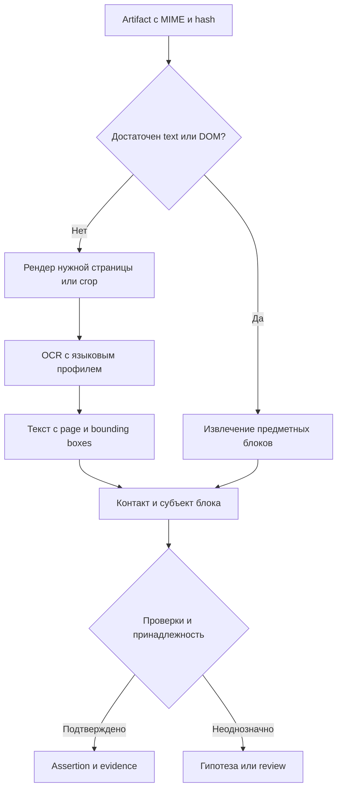

# 9. Выбор инструментов: обход, браузер, OCR и собственный поиск

## 9.1. Актуальное решение и границы выводов

В документации ранее выбран Crawl4AI. Последнее уточнение пользователя разрешает заменить его более подходящим open-source решением или использовать несколько инструментов. Поэтому прежний выбор рассматривается как исходная база сравнения, а не неизменяемое ограничение.

**Рекомендация для будущего прототипа собственного контура:** Crawlee for Python как основной runtime получения HTTP/Playwright-страниц; Crawl4AI — обязательный участник сравнительного испытания и возможный специализированный extractor. Playwright является механизмом браузера, а не ещё одним независимым полным краулером. Firecrawl продолжает обслуживать demo до приёмки собственного пути.

Это инженерная рекомендация по прочитанным первичным материалам, а не результат замера. Контракт acquisition фиксируется независимо от победителя. До cutover сравниваются Crawlee Python, Crawl4AI и действующий Firecrawl на одинаковых источниках и лимитах. Если Crawl4AI обеспечивает нужное управление, качество и стоимость проще, он может остаться единственным собственным runtime без изменения предметной архитектуры.

Главная причина рекомендации Crawlee — наша задача требует контроля очередей, HTTP/browser маршрутов, сессий, повторов и отдельных предметных извлекателей. Готовый LLM-ready Markdown полезен, но не заменяет сохранённый DOM, точную принадлежность контакта и управление посещением сайта.

## 9.2. Сравнение crawler frameworks

| Вариант | Подтверждено документацией | Для нашей задачи | Ограничение решения |
|---|---|---|---|
| Crawl4AI | Асинхронное получение, browser hooks, CSS/XPath/regex/LLM extraction, Markdown, deep/adaptive crawl, сессии/proxy | Быстрый предметный прототип, извлечение страниц для LLM | Markdown может потерять контекст; self-hosted package не даёт hosted web search; queue/evidence acceptance нужен отдельно |
| Crawlee Python | HTTP и Playwright crawlers, storage/queue, retries, sessions/proxy, локальный запуск | Предпочтительный runtime первого собственного прототипа | Python-версия оценивается самостоятельно; нельзя переносить на неё каждую возможность TS-версии |
| Crawlee TypeScript | HTTP/headless interface, persistent queue, autoscaling, hooks, sessions, proxy | Сильная альтернатива, если нужная функция отсутствует в Python | Новый Node runtime и второй стек обслуживания; не добавлять параллельно без измеримой причины |
| Scrapy + scrapy-playwright | Spider pipeline, selectors, scheduler, JOBDIR/resume, AutoThrottle; отдельный browser handler | Массовые стабильные источники, каталоги, реестры | Интеграцию browser/session и наши evidence contracts всё равно проектировать; отдельный runtime первой версии не нужен |
| Playwright напрямую | Браузер, DOM, события, локаторы, скриншоты, контексты | Основа адресных сценариев и тестов | Нет готовой полной предметной очереди/памяти исследований |
| Browser Use | Агент с инструментами и структурированным выводом поверх local/cloud browser | Ограниченный исследовательский режим незнакомого интерфейса | Цена, вариативность модели, контроль эффектов; не замена crawler scheduler |
| Stagehand | observe/act/extract, локальный браузер, схемы данных, SDK | Полуавтоматическое создание и сопровождение site recipes | Совместимость конкретной версии/модели и воспроизводимость требуют trial |

Источники: [S03–S06](08-research.md#s03), [S29](08-research.md#s29), [S33–S35](08-research.md#s33), [S49–S52](08-research.md#s49). Заявленные upstream показатели скорости/качества не используются как наши результаты.

## 9.3. Нужно ли множество краулеров

Нужны несколько **режимов получения** и сменяемые адаптеры. Не требуется с первого дня содержать пять одинаковых crawler clusters.

Стартовая лестница стоимости:

1. Exact lookup в памяти или реестре.
2. HTTP fetch → исходный HTML → структурированные данные/DOM.
3. Browser render для JS-содержимого.
4. Детерминированный сценарий взаимодействия с интерфейсом.
5. PDF/image extraction, OCR нужного фрагмента.
6. Ограниченный LLM browser planning, если предыдущие способы не дали ответа и режим явно разрешён.

Шаги не всегда строго последовательны: известный PDF сразу идёт в document pipeline; известная JS-карточка — в browser profile. Router выбирает профиль по MIME, source recipe, пробелу dossier, бюджету и истории. Ошибка сети не превращается автоматически в необходимость дорогой LLM.

Дополнительный runtime принимается только при измеримом приросте корректных контактов/доказательств, снижении стоимости или закрытии отдельного класса источников. Нужны прирост относительно основного движка, стоимость владения и нагрузка на оператора. Один удачный screenshot не доказывает полезность постоянно запущенного второго краулера.

Temporal управляет миссией, frontier service — предметной очередью URL, Crawlee/Scrapy — своей внутренней очередью выполнения. Нельзя независимо возобновлять три очереди так, чтобы они повторяли один оплаченный шаг. Action ID, lease, completion receipt и crash recovery связывают уровни.

## 9.4. Что значит «эмулировать поведение»

Продуктовая цель — получить публичное содержимое так, как его открывает пользователь: дождаться JS, прокрутить список, перейти по странице каталога, раскрыть вкладку контактов, нажать доступную кнопку показа телефона, выбрать локаль или выполнить публичный поиск.

| Класс | Пример | Режим |
|---|---|---|
| B0 | HTTP/HTML, JSON-LD, sitemap | Без браузера |
| B1 | Render, ожидание DOM, lazy loading | Версионированный browser profile |
| B2 | Scroll, pagination, открыть read-only вкладку | Проверяемый site recipe, ограничение шагов |
| B3 | LLM предлагает действие на незнакомой странице | Отдельная будущая capability activation после изменения действующего ограничения автономных кликов |
| B4 | Отправить сообщение, заявку, форму обратной связи | Действие outreach с точным утверждением; вне исследовательской сессии |

Публичная поисковая форма может отправлять POST без коммуникации с человеком. Политика проверяет смысл и allowlist endpoint, а не только HTTP-метод. Нельзя считать любой GET безвредным или любой POST отправкой письма.

У нас сейчас действующая спека исключает автономные клики. Эта концепция проектирует B3, но не объявляет его разрешённым в текущем demo. До активации обязательна отдельная MODIFIED-дельта `osint-enrichment` с границами, затем проверка. Известные scripts/read-only profiles также должны соответствовать effective source policy.

«Человеческое поведение» не требует хаотичных движений мыши и случайных задержек. Нужны корректные browser semantics, ожидание конкретного состояния DOM, ограничение частоты, согласованные locale/timezone/session и доступный публичный интерфейс. Изменение fingerprint не гарантирует доступ. CAPTCHA/ограничение доступа — наблюдаемый исход, для которого есть остановка или иной разрешённый источник; бесконечные повторы расходуют бюджет и ухудшают диагностику.

## 9.5. Browser action contract

Сценарий хранит `recipe_ref`, версию, начальный URL, разрешённые origin/пути, страну/locale, session-purpose, предел времени/действий/трафика и ожидаемое наблюдение. Сессия изолирована по tenant/source/purpose; её cookies не попадают в LLM prompt или публичный trace.

Каждое действие:

1. Прочитать разрешённый DOM/accessibility snapshot; при необходимости ограниченный screenshot.
2. Получить зарегистрированное действие: navigate, wait_for, scroll, click_readonly, fill_public_search, read_attribute, download_document.
3. Проверить locator по текущему DOM, смысл элемента, origin и лимиты.
4. Выполнить один шаг, сохранить before/after hashes, URL, время, результат и полученный artifact.
5. Проверить ожидаемую постусловие: появился контактный блок, вырос список, загружен PDF. Отсутствие ошибки API не равнозначно успеху задачи.

LLM не получает произвольный Python/JavaScript, shell или ключи. Самостоятельно найденная кнопка «Отправить» не становится разрешённым действием. Инструкции внутри страницы рассматриваются как данные источника, не команды исполнителю.

Сохранённый recipe содержит устойчивые locators/семантику и fixtures. После редизайна — ограниченная диагностика, новая версия и повторная проверка, а не тихая запись случайного найденного телефона.

Stagehand подходит как кандидат помощи `observe → проверка → act`; Browser Use — как кандидат ограниченного B3. **Не подключать оба по умолчанию.** Для Python-first прототипа первым сравнивается Browser Use с нашими прямыми Playwright recipes; Stagehand остаётся альтернативой. Модель DeepSeek из demo не считается автоматически vision/tool-compatible: нужен capability probe и отдельный профиль модели для текста/зрения.

## 9.6. Извлечение до OCR

HTML/DOM, `mailto:`, `tel:`, подписанные предметные блоки и JSON-LD читаются раньше screenshots. JSON-LD `Organization`/`LocalBusiness` — утверждение издателя, а не доказательство государственной регистрации. Данные относятся к субъекту блока: нельзя раздать телефон из footer каталога всем компаниям списка.

Trafilatura полезна для основного текста/описания, но по замыслу удаляет повторяющиеся header/footer. В контактном исследовании там часто лежат реальные реквизиты. Поэтому сохраняются raw DOM и отдельные legal/contact scopes; режим main text не является единственным представлением.

Для PDF сначала проверяются text layer, кодировка, порядок чтения и таблицы. `pdfplumber` подходит для символов/координат и таблиц machine-generated PDF; библиотека не заменяет OCR скана. Наличие большого текстового слоя не гарантирует корректного текста: нужны проверки мусорных glyph mappings и утраченных столбцов.

## 9.7. Выбор OCR/document инструментов

| Инструмент | Предлагаемая роль | Что проверить до внедрения |
|---|---|---|
| Docling | Основной кандидат document conversion/layout, порядок чтения, таблицы, единый структурированный документ | Профиль OCR backend, координаты/связь с оригиналом, CPU/GPU, лицензии конкретных весов |
| PaddleOCR | Основной кандидат multilingual OCR engine для изображений и сканов | Конкретная модель и набор языков; координаты; CPU/GPU; ошибки цифр/email; лицензия весов |
| Tesseract | Лёгкая CPU-база сравнения/резерв для подходящих языков и чётких изображений | Language packs, качество мелкого/искажённого текста, координаты и confidence |
| Surya | Альтернативный layout/OCR для корпуса, где даёт измеримую выгоду | Отдельные условия коммерческого использования весов; не принимать лицензию кода за лицензию модели |
| Unstructured | Альтернативный document partitioning pipeline | Не дублировать Docling без прироста; open-source library и managed Transform имеют разные возможности |
| Vision LLM | Эскалация неоднозначного crop/сложной структуры | Выдуманные символы, стоимость, модельный профиль; не источник точного номера без проверки |

Рекомендация: Docling как document adapter и PaddleOCR как OCR adapter за раздельными контрактами; Tesseract — baseline, а не обязательный параллельный production pool. Возможность вызова выбранного PaddleOCR backend из конкретной версии Docling проверяется; если native adapter отсутствует, композиция делается нашим worker, без обещания готового upstream соединения.

Docling лицензирует код MIT и отдельно отсылает к лицензиям моделей. PaddleOCR публикует Apache-2.0 для проекта, но выбранные model artifacts также фиксируются и проверяются. Surya прямо различает Apache-2.0 для кода и условия весов с ограничениями коммерческого использования. Поэтому Surya не является безусловно свободной заменой для любого бизнеса ([S36–S41](08-research.md#s36), ledger с license sources).

## 9.8. OCR pipeline с доказательствами

Для каждого значения хранятся исходный image/PDF hash, URL, page/frame, bounding polygon, размер и система координат, crop transform/DPI, исходная OCR строка, нормализованное значение, версия engine/model/language/preprocessing и метод оценки уверенности. Crop всегда восстанавливается относительно сохранённого оригинала; внутренние координаты resized изображения нельзя показывать как координаты PDF.

OCR confidence не является вероятностью принадлежности контакта компании. Нельзя по одному числу усреднять точность распознавания, валидность номера и доказательство связи. Низкое качество чтения критического символа ведёт к повторному чтению другим способом/источником либо review.

Примеры:

- `sales@acrne.example` и `sales@acme.example`: сохраняются исходные варианты; LLM не заменяет `rn` на `m` молча.
- О/0 и I/l/1 в регистрационном номере: checksum может отсеять вариант, но не доказывает существование записи; нужен lookup.
- Несколько компаний на одном скане: границы карточек/строк и заголовки сохраняются, единый массив всех телефонов не назначается всем субъектам.
- Номер возле иконки мессенджера: фиксируется наблюдаемый тип канала; наличие цифр не превращается в email-ready.
- QR/vCard: возможный дополнительный decoder с сохранением crop/payload и последующей проверкой URL/контакта; не автоматически выполняемое содержимое QR.

Ограничения страницы, пикселей, размера файла, распаковки, CPU/GPU и времени действуют до обработки. Длинный PDF обрабатывается по нужным страницам; одинаковый разрешённый artifact/профиль можно переиспользовать в своей области, избегая повторной оплаты OCR. При отзыве источника/retention удаляются соответствующие crops, индексы и производные наблюдения.

## 9.9. Поисковики на нашей платформе

Нужны три продукта с единым интерфейсом, но разными источниками результата:

1. **Внутренний поиск компаний и доказательств.** Exact ID/alias, структурные фильтры, lexical и semantic retrieval по разрешённому корпусу. PostgreSQL FTS + pgvector достаточны для первого этапа; непрерывно обновляемые проекции обслуживают UI и agent tools.
2. **Интернет discovery gateway.** Self-hosted SearXNG как дополнительный метапоисковый backend; независимый regional API как контролируемый канал покрытия/доступности. Необходимость API сохраняется, если нужные upstream источники метапоиска недоступны.
3. **Собственный вертикальный web index.** Приоритетные страны/отрасли/реестры и известные домены; собственные frontier, acquisition, dedup, extraction, indexing, recrawl и ranking. Это реальное накопление независимого корпуса.

| Проект | Что предоставляет | Предлагаемое место |
|---|---|---|
| SearXNG | Федерация поиска внешних движков | Вторичный backend gateway, качество/лимиты каждого upstream видны |
| YaCy | Собственный crawler/index/search, optional P2P | Отдельный эксперимент для независимого корпуса; P2P выключен для tenant data |
| Apache Nutch | Компоненты крупного web crawling/indexing ecosystem | Кандидат будущего масштабного сбора; перед выбором читать точные deploy/plugin contracts |
| OpenSearch | Search/observability платформа | Предпочтительный следующий кандидат индекса при измеренном росте после PostgreSQL |
| Vespa | Поиск и ranking по текстам, векторам и структурным данным | Альтернатива для сложного ranking, если оправдана операционная стоимость |
| Meilisearch | Поиск внутри приложения | Возможная UI-проекция, не внешний discovery или web crawler |
| Common Crawl index | Поиск URL/снимков в существующих коллекциях | Вспомогательное обнаружение старых доменов/страниц; не свежая полная поисковая выдача |

Источники: [S21–S22](08-research.md#s21), [S30](08-research.md#s30), [S43–S48](08-research.md#s43). Nutch README содержит преимущественно developer/build информацию: конкретная схема крупного обхода здесь ещё не подтверждена испытанием. Readme не доказывает готовую интеграцию Nutch → выбранный search cluster.

Для малого пилота не ставим одновременно OpenSearch, Vespa и Meilisearch. Критерий выхода из PostgreSQL: воспроизводимое нарушение latency/throughput или ranking requirements на реальном объёме и типах запросов. Отдельный cluster должен сохранять tenant/purpose/retention фильтры и корректное удаление.

В UI у результата виден тип источника: наш актуальный dossier, наш документ, внешний поисковый кандидат, метапоиск или архив. Сниппет внешнего поиска не считается прочитанной страницей. Archived URL не подтверждает текущую работу контакта; перед использованием требуется актуальное приобретение/проверка.

## 9.10. Кроме краулеров и поисковиков

Обязательные части собственного контура:

- **Source registry:** доступные страны, типы источников, условия получения, parser recipes, лимиты, качество и владельцы адаптеров.
- **Query planner:** локальные отраслевые термины, регистрационные ключи, стратегии уточнения и остановка повторов.
- **Frontier/scheduler:** приоритет, host limits, дедупликация задач и устойчивое возобновление.
- **Browser/session pool:** отдельные контексты, egress profiles, ресурсы, наблюдаемое завершение зависших sessions.
- **Artifact storage:** raw HTML/PDF/image, hashes, locators, tenant access, retention и lineage.
- **Parsing/document/OCR workers:** разные ресурсы и честный capability manifest.
- **Entity resolution:** типы субъектов, сильные ID, гипотезы/противоречия, обратимые merge decisions.
- **Contact verification:** контекст назначения и принадлежность, страновая нормализация, актуальность и доступность канала.
- **Memory/retrieval:** факты, эпизоды, отрицательные результаты с TTL, индексы и ограниченные графовые пути.
- **Model gateway:** text/vision/tool capabilities, structured output, стоимость, версии и безопасный ограниченный вход.
- **Budget ledger:** резервирование и фактический расход search/proxy/browser/OCR/LLM/storage.
- **Review/observability UI:** причины действий, пробелы, evidence, исходы и очередь спорных случаев.
- **Outreach/feedback:** разрешённый адресат, материал и решение оператора, доставка и обновление памяти.
- **Evaluation harness:** размеченный независимый корпус, field-level/contact-link precision и regression suite каждого parser/model upgrade.

Это логические компоненты, не требование создавать 14 микросервисов. Вначале Go-контексты, существующий PostgreSQL/Temporal, один acquisition worker и отдельный document/OCR worker при необходимости; browser и GPU tasks масштабируются отдельно после измерений.

## 9.11. Как выбирать на фактах

Предлагаемый benchmark: 120 разрешённых страниц/документов, не использованных для подбора recipes: static HTML, JS contacts, pagination/reveal, directories с footer-trap, text PDF, scanned PDF/image, mixed-script/multilingual, устаревшие и конфликтующие сведения. Категории пересекаются; итоговый manifest фиксирует ровно 120 объектов и распределение по RU/GB и расширяемым рынкам.

Одинаковые budgets, allowed routes, snapshots и единица правильного результата. По каждому движку измерять:

- Долю корректно полученных artifact и точную полноту представлений/locators.
- Precision/recall каждого contact field и **contact-to-subject link**, exact match критических цифр/email.
- Ошибочные объединения и ложные контакты издателя/директории.
- Степень покрытия JS/OCR по языкам и классам документов.
- Стоимость корректного уникального email-ready результата, включая неудачные попытки.
- P50/P95 времени, CPU/GPU/RAM, proxy bytes, search calls, tokens, ручные минуты.
- Resume/dedup, корректность geography receipt, воспроизводимость и сложность поддержки.

Для multi-engine сравнить не только суммарный recall, но и **добавочную полезность**: сколько подтверждённых результатов второй движок нашёл сверх первого и сколько это стоило. Второй OCR не считается независимым источником факта: он повторно читает тот же artifact.

Версии библиотек, модели и веса фиксируются с hashes/лицензиями. Цифры upstream README, включая «human-like», «SOTA» и скорость на чужой GPU, не используются как доказательство качества у нас. До собственного запуска ни один кандидат здесь не объявлен прошедшим acceptance.
