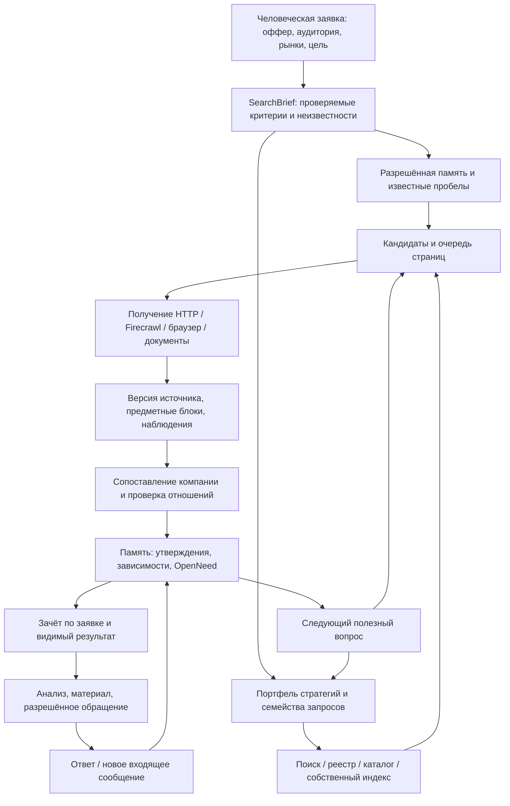

# 11. Поиск лидов и краулинг: рекомендуемая реализация

**Статус:** уточнённый проект, подготовленный по аудиту change и кода `bbe49f6`; выполнение задач этим документом не заявляется. Последнее уточнение пользователя CL-15: главный предмет проработки — поиск компаний и краулинг; прежние примеры задают ориентиры и допускают обоснованное уточнение решений. Требования, факты кода, опубликованные возможности инструментов и гипотезы различаются в [аудите](12-change-audit.md).

**Уточнение CL-16:** денежный бюджет приложения ограничивает только операции Firecrawl. Остальные инструменты используют существующий proxy без второго финансового лимита/резервирования. Таймауты, параллельность, глубина и защита от повторов — отдельные технические настройки. Наличие proxy само по себе не подтверждает географию выхода.

## 11.1. Какой результат строим

Человек описывает предложение и желаемую аудиторию, выбирает рынки, единицу результата и предел кредитов Firecrawl и технические условия остановки. Система находит ещё неизвестные подходящие под критерии компании, сохраняет их даже без контактов, добывает недостающие сведения, устанавливает принадлежность контактов и объясняет каждый принятый результат. Отдельные заявки пополняют разрешённую долговременную память. Поздний источник может дополнить ранее найденную компанию.

Главный критерий поиска — количество устойчиво сохранённых уникальных субъектов, принятых по заданным критериям, и технические затраты на такой результат. Отдельно учитываются кредиты Firecrawl; цены proxy-инструментов не нужны для допуска действия. Число страниц, извлечённых строк, сообщений LLM и поисковых выдач показывается как работа инструмента. Ни одно из этих чисел не заменяет число компаний.

Письма, формы, входящие обращения и ответы остаются в полной программе. Они потребляют проверенные сведения и возвращают новые наблюдения. Их полная реализация не является условием первого работающего поиска от описания аудитории до досье.

## 11.2. Что уточнил аудит исходной концепции

Предыдущая версия подробно объясняла цепочку от известного номера до контакта. Для поиска компаний с нуля не хватало самостоятельных моделей поискового задания, портфеля стратегий, семейства запросов и очереди discovery. Поэтому рекомендуем разделить два непрерывно взаимодействующих процесса:

- **Discovery:** получить новые кандидаты из поисковой выдачи, каталогов, реестров, списков участников/поставщиков, документов и разрешённого собственного корпуса.
- **Enrichment:** установить идентичность кандидата, сайт, роль контакта, актуальность и недостающие связи.

Координатор распределяет доступную вычислительную ёмкость между ними и кредиты Firecrawl для использующих его действий. Сложная компания с неизвестным email не должна занять всё время и доступную параллельность, пока другие стратегии способны дать новые полезные компании. Найденный кандидат при этом остаётся в памяти и может получить контакт позже.

## 11.3. Сквозная схема

Каждая стрелка, меняющая устойчивое состояние, имеет владельца, версию входов и идемпотентный ключ. Поисковые/браузерные/LLM вызовы выполняются вне открытой транзакции БД. Архитектура исполнения и точные места изменения кода разобраны в [планах задач](task-blueprints.json).

## 11.4. Вход поиска: SearchBrief

Предлагаемая модель — версия исследовательского задания внутри разрешённой миссии, со ссылкой на человеческую заявку. Поля: tenant/purpose, request/criteria version, оффер и его факты, положительные/отрицательные критерии аудитории, страны и языки, требуемый тип субъекта, единица цели, контактные роли/каналы, кредиты Firecrawl, срок и допустимые классы источников.

Каждый критерий разделяется на проверяемое условие и неизвестность. Например, «производитель упаковки в стране X» требует отличить производителя от продавца, регистрацию от обслуживаемого рынка, а коммерческий контакт от поддержки площадки. Наличие сайта или слова «упаковка» не удовлетворяет весь набор автоматически.

LLM может предложить локальные термины, отраслевые коды и исключения. Исходные критерии сохраняются; модель не добавляет обязательные ограничения аудитории из собственного предположения. Изменение рынков, единицы цели или предела кредитов Firecrawl проходит владельца заявки.

## 11.5. Портфель discovery-стратегий

`StrategyCell` задаёт страну/язык, класс источника, поисковое намерение, семейство запросов, лимиты и измеряемые результаты. `QueryFamily` объединяет исходный вопрос и обоснованные варианты, чтобы перестановка слов не обнуляла счётчик повторов.

| Стратегия | Что может дать | Основная проверка |
|---|---|---|
| Категория + география + локальные названия | Первые сайты и карточки компаний | Деятельность и субъект, а не совпадение ключевого слова |
| Отраслевой реестр/ассоциация/выставка | Списки участников или зарегистрированных субъектов | Тип списка, период и связь с искомой ролью |
| Каталог/marketplace/supplier list | Несколько предметных карточек с реквизитами/контактами | Границы карточек, издатель и независимость данных |
| Юридический номер/точное имя/адрес | Идентичность и дополнительные источники | Тип/юрисдикция номера, противоречия, история |
| Известный домен + requisites/contact/local synonyms | Контакты и роли | Принадлежность фрагмента нужному субъекту |
| Новости, тендеры, PDF, вакансии, деловые публикации | Упоминания компаний и гипотезы новых связей | Упоминание не становится тождеством или контактным разрешением |
| Собственный разрешённый корпус | Уже известные компании и пробелы | Актуальность, scope и отсутствие ложного «в интернете ничего нет» |

Для примера «упаковка для пищевых производителей» отдельные семьи ищут производителей, отраслевые объединения, участников выставок и региональные каталоги; затем для найденного субъекта ищутся юридический номер и контакты. Термины переводятся с учётом местного отраслевого употребления. Регистрационный классификатор помогает сужению, но не доказывает актуальную деятельность или интерес к офферу.

Один поисковый провайдер не обязан покрывать все страны и классы источников. Source registry хранит доступные операции, параметры страны/языка, пагинацию, лимиты, цену/неизвестность, правила использования, дату проверки и фактический результат испытания. Поддержка параметра в SDK, доступность API и качество результата являются разными доказательствами.

## 11.6. Как выбирается следующий шаг

Начальная рекомендуемая политика — детерминированный планировщик с ограниченными предложениями LLM. Один вызов модели возвращает небольшой набор типизированных действий, основание и входные ссылки. Системный планировщик решает, какое действие можно исполнить. Внутренний неограниченный цикл агента не входит в этот контракт.

Порядок принятия решения:

1. Проверить сохранённые результаты и незавершённые эффекты: не повторять завершённый поиск ради восстановления контекста.
2. Проверить scope, срок, остаток Firecrawl credits для Firecrawl-вызова, источник, дубли вопроса и попытки стратегии.
3. Закрыть дешёвый пробел, если его проверка с высокой наблюдаемой полезностью завершает принятие кандидата.
4. Выбрать discovery-стратегию, которая ещё имеет доступное покрытие или показывает полезную отдачу.
5. Выделить ограниченный ресурс альтернативным источникам, языкам и гипотезам; фиксировать основание исследования.
6. При отсутствии допустимого полезного действия сохранить объяснимый частичный итог.

Наблюдаемая отдача стратегии — новые различённые субъекты, принятые контакты и результаты по критериям на время/число попыток и использованные Firecrawl credits, с учётом дублей и независимости источников. Формула ожидаемой полезности, доля исследования альтернатив, глубина сайта и пороги переключения — экспериментальные параметры. Их принимаем сравнением с простым фиксированным планом на одинаковом корпусе, технических лимитах и Firecrawl credit cap, где он применяется; уверенность LLM не является измеренной вероятностью успеха.

У миссии единая история действий/попыток и отдельный денежный ledger только Firecrawl. Внешние повторы поиска ради добора и внутренние уточнения запроса используют те же action refs; операции Firecrawl используют тот же credit ledger. Каждый уровень обязан передавать parent/action refs; создание нового технического job не открывает новый Firecrawl credit cap.

## 11.7. Очередь краулинга и выбор страниц

Разделяем очереди discovery-кандидатов, URL для получения, вопросов enrichment и задач пересмотра знаний. Для URL сохраняются нормализованный адрес, способ обнаружения, source/subject hints, действие-родитель, глубина, ожидаемый тип страницы, приоритет, допустимый профиль получения, состояние/lease и история попыток.

Нормализация учитывает фрагменты, tracking-параметры и redirect chain; canonical URL служит подсказкой дедупликации документов. Она не является идентификатором юрлица. Одинаковый контент, URL и субъект дедуплицируются разными ключами. Для календарей, фильтров, пагинации, сортировки и бесконечных query spaces нужны ограничения обхода по семейству URL и источнику.

На сайте компании первыми проверяются реквизиты, контакты, about, филиалы и локализованные варианты этих разделов. В каталоге — карточка нужного субъекта и разрешённая пагинация списка. Статья может дать полезное упоминание или номер компании. Страница без контактов может дать идентичность и следующий URL; её сохраняем по собственным критериям evidence admission.

Глубина/количество страниц, параллелизм по хосту, паузы, повторы и эскалация в браузер имеют явные лимиты. Scheduler учитывает стоимость и полезность страницы. HTTP 429/503, недоступный источник, challenge и пустой результат различаются; одинаковые дорогостоящие попытки без нового основания прекращаются.

## 11.8. Получение страницы: лестница возможностей

| Уровень | Когда применять | Что требуется сохранить |
|---|---|---|
| Поисковая выдача/реестр | Discovery и точный lookup | Запрос, параметры, элементы ответа, источник, стоимость/неизвестность |
| HTTP/Firecrawl scrape | Текст/структурированные блоки доступны напрямую | Версия доступного представления, final URL, время, hash, receipt |
| Браузерный профиль | JS, раскрытие контактов, допустимая пагинация/поиск на сайте | DOM/снимок представления, последовательность разрешённых действий и расходы |
| Документный parser | PDF/office/табличные данные | Страницы/ячейки/блоки и координаты/offsets |
| OCR | Изображение/скан содержит нужные сведения | Исходный артефакт, bbox, текст, неоднозначности и версия модели |

Профиль выбирается по диагностированной потребности. Браузер/OCR не запускаются для всех страниц по умолчанию. Locator относится к реально полученному представлению: если провайдер вернул только Markdown, нельзя выдать выдуманный CSS selector за проверяемое DOM evidence.

Управляемое чтение и взаимодействия с поиском сайта отделены от исходящей формы, которая оставляет сообщение адресату. Автоматическая отправка такой формы требует собственного принятого режима и условий действия.

## 11.9. Рекомендуемый стек получения

Firecrawl сохраняется как рабочий backend до принятия собственного. Для первого собственного runtime рекомендуем испытать Crawlee Python с HTTP/Playwright профилями; Crawl4AI оставить обязательным сравнительным кандидатом. Тонкий HTTP+Playwright baseline нужен, чтобы измерять полезность framework, а не сравнивать только маркетинговые описания.

Выбор этого прототипа является инженерной рекомендацией. Выпуск второго постоянного движка оправдан измеренным приростом корректных связей/покрытия с учётом стоимости сопровождения. Crawl4AI extraction внутри движка не должен создавать неучтённый второй LLM-пайплайн рядом с единым model gateway.

Платформа владеет бизнес-планом, кредитами Firecrawl, техническими лимитами и политикой источника и устойчивыми решениями очереди. Runtime выполняет ограниченное действие/пакет и возвращает артефакты и receipts. Внутренние retries, redirects, subresources и session rotations учитываются как реальные попытки/расход; библиотечный max-pages не объявляется строгим общим лимитом без отдельной проверки. Строгая граница внешних эффектов проектируется до выбора конкретных knobs.

Лицензии проверяются у закреплённых версий, включая полные дополнительные условия, NOTICE, браузерные зависимости и веса OCR. Чтение текущего README/LICENSE не заменяет приёмку выбранного release. Полное сравнение и первичные материалы — [acquisition audit](review/acquisition.md).

## 11.10. Контракт результата acquisition

Предлагаемый результат содержит `invocation_ref`, scope, action/attempt refs, запрос и фактические параметры, исход/ошибку, requested/final URL, redirect/географические сведения, временные метки, версии tools/profiles и фактический расход либо явную неизвестность. Артефакты содержат representation, hash, byte length и locator space.

Получение и техническое извлечение возвращают предметные блоки, упоминания, контактные строки и кандидаты ссылок. Они не объявляют компанию подтверждённой. `lead-management` устанавливает смысл сущностей и отношений. Страница с несколькими компаниями даёт несколько SubjectMention с отдельными границами; footer издателя не наследуется всеми компаниями.

Устойчивое сохранение receipt предшествует учёту результата. Unknown outcome сохраняется для согласования; повтор внешнего эффекта не считается безопасным лишь потому, что локальный процесс не успел записать ответ.

## 11.11. Модель знания и проверок

Рекомендуемая цепочка: `SourceDocumentRevision → Observation → SubjectMention → CandidateLink → AssertionRevision → VerificationEvaluation`. Исходный текст и нормализованное значение сохраняются отдельно. Юридические идентификаторы имеют тип, юрисдикцию и реестр; сильное противоречие останавливает автоматическое тождество.

Утверждение содержит субъект, отношение, объект, временную применимость, scope и версию. Проверка содержит предмет, правило/метод и версию, автора при ручной проверке, основания, дату, исход и пределы. Предметный граф является представлением таких утверждений. Зависимости выводов содержат обязательные и альтернативные достаточные наборы оснований.

Формат email/телефона, принадлежность субъекту, достижимость, актуальность и допустимость действия проверяются раздельно. Валидный диапазон номера не доказывает, что номер назначен нужной компании. Результат OCR, поисковый сниппет и рассказ LLM сохраняют собственные ограничения.

## 11.12. Долговечные пробелы и поздние контакты

`OpenNeed` хранит субъект, требуемое сведение, критерии, scope, ссылки на поручения/попытки и условие пересмотра. Состояние знания (`open/satisfied/blocked/obsolete`) отделено от состояния исполнения (`dormant/attached-to-authorized-run`). Поэтому завершение запуска не скрывает незакрытый пробел.

В T0 сохраняется компания без email. В T1 другая разрешённая работа приносит карточку с тем же подтверждённым номером и email. В T2 политика устанавливает принадлежность, новая версия утверждения закрывает подходящий пробел и обновляет текущее досье. Зачёт каждой активной заявки рассчитывается по её критериям. Завершённая заявка сохраняет прежний снимок и показывает связь с актуальным досье.

Изменение/отзыв/устаревание evidence, merge/split запускают адресный идемпотентный пересмотр. Единственное отозванное основание снимает зависимое подтверждение; другое достаточное основание может сохранить его. Обновление памяти само не создаёт клиентскую заявку, новый бюджет или отправку сообщения.

## 11.13. Хранение и поиск в памяти

Начальный вариант — отдельные scoped таблицы PostgreSQL у владельцев данных: entity/identifier, document revision/evidence/mention, assertion/evaluation, dependencies/support sets, open needs, mission/action/attempt/cost refs и result membership. Каждый уникальный ключ и доступ учитывает действующую tenant/purpose область. Конкретные миграции и constraints перечислены в [identity audit](review/identity_memory.md).

Exact identifiers и lexical/FTS retrieval принимаются первыми. Embeddings добавляются как дополнительный recall с фильтрацией области до выбора результатов и проверкой отзыва. Нынешний vector port нельзя считать готовым pgvector решением: его фактические schema/контракты и ограничения разобраны в аудите. Отсутствие embedding API не блокирует базовый discovery и память.

Текущий domain-based CompanyID не становится ключом новой сущности. Совместимость обеспечивает явный scoped bridge с проверкой владельца и неоднозначности; автоматическое массовое перезаписывание старых ключей не входит в этот переход.

### Размещение payload и границы модели

`agent-orchestration` получает клиентский red repository `research_payload(tenant, payload_id, revision, kind, hash, body, expires_at)` для brief, query и prompt context. Green/Temporal/outbox хранят разрешённые типизированные поля, версии и opaque refs. Новый client research-executor разрешает refs и вызывает инструмент без долгой DB-транзакции. `lead-management` red хранит evidence/содержимое/locators; первый bounded срез может использовать bytes/bytea, затем вводится реальный blob adapter. Готовый reusable object store в проверенных контекстах не найден.

Технический frontier принадлежит `integration-platform`, но URLs/параметры размещаются в клиентском контуре: unique `(scope, action_id, target_fingerprint, profile_revision)`, state, lease epoch/expiry, attempts и provider job ref. Python получает ограниченную задачу и возвращает ссылки/receipts. Assertions являются источником отношений; relations — проекции. Состояние знания, актуальность и доступность раздельны. Достаточность доказательств выражается AND/OR support sets с запретом циклического самообоснования; уверенность не выводится из числа копий одного источника.

## 11.14. Исполнение, конкуренция и восстановление

Каждое внешнее действие проходит `intent + outbox → execution → receipt → apply result` с короткими транзакциями и проверкой версии. Для Firecrawl после intent следует `awaiting_fc_reservation → ReserveForAction(action_id, grant_ref) → reservation receipt → ready/dispatch`. Единственный ledger находится у `integration-platform`: account cap и mission/study grant ограничивают одну запись. После crash состояние восстанавливается через GetReservation(action_id), без общей cross-context транзакции. Остальные маршруты не ждут app financial reserve. В истории сохраняется модель/версия prompt, входные refs, принятое предложение, фактическая попытка и расход. Повтор сообщения проверяет идемпотентность; устаревший результат не откатывает текущую проекцию.

В момент конкурирующего последнего слота две подходящие компании могут обе сохраниться в памяти, а зачёт заявки остаётся ограниченным её атомарным правилом membership. Пересчёт merge/revoke меняет активный зачёт с объяснением. Пауза/отмена/окончание срока завершают управляемое исполнение, сохраняя полученные допустимые данные и неизвестные исходы для согласования.

Новый путь не должен просто вызывать внешний planner внутри старого `RunStep` UoW. Фактический legacy протокол и нужное разделение указаны в [orchestration audit](review/orchestration.md).

## 11.15. Международность

Country profile описывает supported operations и проверенные источники, local terms, identifiers/phones, языки и географию. Отдельно фиксируются страна регистрации, присутствия/продаж, выдачи, locale браузера и сетевого выхода. Proxy IP не заменяет параметр страны поискового API.

РФ остаётся начальной проектной трактовкой пользовательского «русский», выбор стран и исследование международных рынков сохраняются. Пилотные страны принимаются по доступным источникам и результатам trial; наличие кода страны в enum не означает готовое покрытие. Для каждого рынка видны `documented / trial-passed / limited / unavailable` с причиной и временем проверки. Конкретные источники и неизвестности — [markets/search audit](review/markets_search.md).

## 11.16. Контакты, письма и обратная связь как продолжение поиска

Досье передаёт потребителю конкретные версии подтверждённых фактов, адресата и ограничений. Подготовка письма использует разрешённые утверждения; отправка проверяет неизменность выбранного получателя и материала. Точный получатель требует immutable snapshot/version: legacy resolver, возвращающий текущий первый email компании, этого свойства не обеспечивает.

Входящее письмо или форма может дать новый контакт, юридический номер, роль или исправление. Оно проходит durable intake, tenant routing, дедупликацию, корреляцию и предметную проверку. Текст ответа не становится реестровым подтверждением автоматически. Реальный mailbox/Reply-To, threading и версии envelope — отдельная ветвь реализации после основного поиска; [communications audit](review/communications.md) связывает её с текущими контрактами.

## 11.17. Как измеряем качество

Корпус делится по source family, компаниям, странам, языкам и типам документов; соседние копии не попадают одновременно в обучение правил и независимую оценку. Фиксированный стартовый corpus проверяет сценарии и сравнивает алгоритмы. Статистическое заявление о precision требует собственного достаточного числа независимо оценённых связей; число страниц само по себе его не задаёт.

Метрики: candidate/entity/contact-link precision и recall, ложные объединения, доля компаний с нужным контактом, прирост уникальных результатов по стратегии, доля повторного использования памяти, стоимость принятого результата, latency, необъяснённый недобор, ручная проверка и ошибки scope. Качество считается отдельно по стране/источнику/типу документа, с размером выборки и неопределённостью.

Испытания сравнивают фиксированный поиск с адаптивным планированием, HTTP с JS escalation, Firecrawl с собственным runtime, обычное извлечение с OCR и exact/FTS с добавленным semantic recall. Гипотеза принимается по наблюдаемому полезному результату и стоимости. Порог приёмки назначается до измерения, а не под результат выбранного инструмента.

## 11.18. Порядок реализации

| Шаг | Проверяемый результат | Что разблокирует |
|---|---|---|
| S0. Границы и фундамент | Scope/identity/storage, source capabilities, intent/result протокол и минимальный durable Firecrawl grant/ledger до платных действий, измеримый corpus; совместимость нового пути | Устойчивую запись реальных discovery результатов |
| S1. Discovery из брифа через Firecrawl | Версия SearchBrief, несколько обоснованных query families, реальные кандидаты и источники в памяти/UI, даже без email | Доказательство, что платформа находит компании с нуля |
| S2. Прицельный обход и проверенный контакт | Очередь страниц, subject blocks, identity/link проверки, OpenNeed и позднее обогащение | Зачёт единиц «компания с контактом» |
| S3. Адаптивность и добор | Единая история попыток, повторное использование Firecrawl grant при доборе, портфель стратегий, bounded planner, видимый прогресс и честный итог по цели | Сравнение качества/цены полного поиска |
| S4. Собственный runtime и расширение источников | Сравнительная приёмка HTTP/browser/OCR, proxy/search geography, cutover/rollback | Развитие собственного acquisition без потери рабочего Firecrawl пути |
| S5. Материалы и обратная связь | Версии адресата/материала, рабочие формы/mailbox, разговоры и новые входящие evidence | Полный цикл поиска и общения |
| S6. Расширение рынков и эксплуатационная приёмка | Per-country coverage, нагрузка, миграции/восстановление и полный E2E | Приёмку всей программы |

Это рекомендуемый порядок с параллельными работами: международные контракты закладываются в S0/S1, исследование собственного runtime начинается заранее, а дополнительные страны принимаются по мере готовности. S5 не блокирует S1–S4. Точный task DAG, зависимости и проверяемые выходы представлены в [task-blueprints.json](task-blueprints.json); конкретный apply-срез берётся из готовых по зависимостям задач.

## 11.19. Что считается точностью плана

Точная реализация здесь означает определённые владельцы, состояния, контракты, ограничения транзакций, места изменения кода, порядок зависимостей и критерии проверки. Будущие показатели качества, стоимость провайдера, лучший crawler или универсальные пороги не выдаются за установленные факты. Для них существуют отдельные эксперименты и fallback.

Перед применением первого среза выбирается зафиксированная версия инструмента и выполняется реальная проверка соответствующей интеграции. После каждого среза обновляются facts/evidence и открытые гипотезы; полный объём и исходные пользовательские уточнения сохраняются в [реестре](../../intelligent-lead-platform-roadmap.md).
