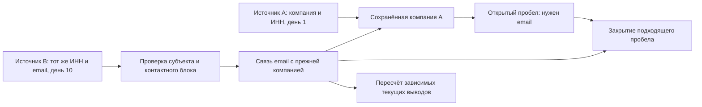

# Интеллектуальная система исследования компаний и исходящих коммуникаций

**Статус: концепция и план, не реализованный продукт.** Исследование источников: 15 октября 2026 года. Ветка: `concept/intelligent-lead-research`. Исходная рабочая версия: `8977438`. OpenSpec: [intelligent-lead-research](../../../openspec/changes/intelligent-lead-research/proposal.md).

**Полный объём обязателен к реализации:** [36 требований, задачи и применение исследования](../../intelligent-lead-platform-roadmap.md). Все 66 материалов имеют связь с решениями в [implementation-coverage.json](implementation-coverage.json). S0–S6 ставят discovery и краулинг первыми; R1–R4 остаются проверочными сценариями; международные рынки, собственный поиск/краулер, browser/OCR, формы и входящие ответы остаются в полной программе.

**Ваши ответы и уточнения:** [цитаты CL-00…CL-17 и их связь с требованиями](../../intelligent-lead-platform-roadmap.md#ваши-уточнения-из-переписки). Там отдельно отмечены рекомендации ассистента и нерешённые продуктовые вопросы, чтобы их не выдавать за ваши решения.

## Единая концепция: от общего к частному

### 1. Цель продукта

Строим постоянно пополняемую систему знаний о компаниях, их деятельности и каналах связи. Человеческие заявки используют и дополняют эти знания, задавая конкретный оффер, аудиторию, страны, количество результатов, кредиты Firecrawl и технические условия остановки. Компания живёт в памяти дольше отдельного поиска: если сегодня email не найден, поздняя находка может дополнить ту же компанию через неделю или в другой разрешённой исследовательской работе.

Ценность продукта — накопленные проверяемые знания и возможность довести их до делового общения: найти нужный субъект, установить контакт, подготовить обоснованное обращение, выполнить утверждённое действие, получить ответ и учесть его в дальнейшей работе. Полный состав функций сохраняется в [обязательной программе](../../intelligent-lead-platform-roadmap.md).

### 2. Что является основными объектами

Компания, юридическое лицо, бренд, филиал, сайт и контакт имеют разные идентичности и типизированные связи. Страница — версия источника; извлечённый фрагмент — свидетельство; фраза «этот email обслуживает компанию A» — утверждение, требующее основания. Заявка задаёт критерии применения этих знаний, а оценка соответствия относится к её версии.

Неполная карточка компании сохраняется вместе с известным и неизвестным. «Email не найден на странице X при проверке T» является ограниченным результатом попытки. Он не означает «у компании нет email». Сохранение компании, подтверждение её идентичности, нахождение контакта и готовность письма — отдельные результаты.

### 3. Сквозной пайплайн

1. Человек создаёт заявку с оффером, аудиторией, рынками, единицей цели и ограничениями; предусмотренное одобрение выполняет соответствующая человеческая роль.
2. Система ищет уже известные компании и факты в разрешённой памяти, проверяет актуальность и выявляет пробелы.
3. LLM предлагает полезные вопросы и следующие действия: найти номер, установить название, проверить сайт, прочитать другую карточку, найти контакт или разобрать документ.
4. Исполнитель выполняет разрешённый поиск, crawl, browser/OCR либо registry lookup, учитывает расход и сохраняет версию источника.
5. Извлечённые данные проходят сопоставление субъекта, проверку принадлежности, формата, противоречий и актуальности. Наблюдения и гипотезы сохраняются со своими статусами.
6. Подтверждённые связи дополняют существующее досье, закрывают подходящие пробелы и пересчитывают зависимые текущие представления. По критериям заявки отдельно считается принятый результат.
7. Анализ по офферу даёт материал письма или обращения через форму с реальными контактами отправителя. Владельцы канала проверяют адресата, точную версию материала и условия действия.
8. Отправка, входящая форма, новое письмо или ответ пополняют историю общения и знания. Новое обращение создаёт либо дополняет лид; ответ связывается с перепиской и меняет дальнейший шаг.

### 4. Сеть знаний и зависимостей во времени

Есть две связанные сети. Предметный граф хранит отношения «номер принадлежит юрлицу», «сайт представляет компанию», «контакт обслуживает компанию». Граф зависимостей хранит, какие версии свидетельств поддерживают утверждение, какие решения на него опираются и какие резюме, карточки или подготовленные материалы требуют пересмотра при изменении основания.

Пример: в первом источнике нашли ООО «А» и проверили ИНН, email отсутствует. Сохраняем компанию и потребность «найти email отдела продаж», оставляя историю попыток. Через время другая разрешённая работа находит карточку с тем же ИНН и email именно в контактном блоке этой компании. Проверяем связь, добавляем контакт к прежней компании и указываем источник и дату. Совпадение одного названия или email владельца каталога остаётся недостаточным основанием.

Новое свидетельство вызывает адресный пересмотр зависимостей. Если единственное основание отозвано, подтверждение снимается и пробел может открыться снова. Если осталось другое достаточное независимое основание, статус определяется по нему. Все изменения версионируются. Завершённый запуск хранит исторический снимок; текущее досье может стать полнее позже.

Открытый пробел не равен бесконечному платному поиску. Разрешённая активная миссия может продолжить проверку в пределах срока, стран и технических caps; для Firecrawl также его кредитного grant. После завершения обновляются память и уведомление; новый поиск или отправка требуют действующего поручения и разрешённого действия. Между tenant и назначениями обработки знания самовольно не переносятся.

### 5. Что означает «проверено» и «достоверно»

Достоверность описывается для конкретного утверждения и конкретной проверки. У каждой связи видны основание, способ и версия проверки, дата, применимость, противоречия и ограничения. Число сайтов или уверенность LLM не заменяют предметное подтверждение; копии одного источника не создают независимых доказательств.

| Измерение | Что показываем пользователю |
|---|---|
| Надёжность источника | Пригодность источника для данного типа сведений: реестровые реквизиты, контакты, роль; ограничения и независимость |
| Качество извлечения | Воспроизводимый фрагмент и метод; для OCR — неоднозначные символы и качество распознавания |
| Состояние утверждения | Найдено в источнике / гипотеза / подтверждено по правилу / подтверждено человеком / конфликт / опровергнуто |
| Идентичность субъекта | Компания различена; юридический ID подтверждён либо пока неизвестен |
| Принадлежность контакта | Кому относится email/телефон и чем это подтверждено |
| Формат | Корректен, неоднозначен либо некорректен; исходное значение сохранено |
| Достижимость | Не проверена либо проверена конкретным методом и датой; ограничения метода видны |
| Актуальность | Применимо сейчас, устарело, отозвано либо срок неизвестен |
| Применение | Соответствие конкретной заявке и отдельный допуск конкретного действия |

Надёжность источника, качество извлечения и подтверждение утверждения — разные характеристики. Высокая OCR confidence не доказывает истинность распознанного текста; реестр не подтверждает доставляемость email.

Пример карточки: «Компания подтверждена по реестру. Email связан с компанией по карточке каталога от 10-го числа. Формат корректен. Достижимость ящика не проверена. Отправка ожидает решения». Для ручной проверки фиксируются автор и основание; отметка человека не подтверждает автоматически все остальные измерения.

### 6. Роль LLM и памяти

LLM формулирует гипотезы, выбирает полезный следующий вопрос, помогает разбирать сложный источник, анализирует компанию и готовит текст. Структурированные проверки определяют, какие утверждения можно принять и использовать. Исполнитель отвечает за доступ, версии, сохранение, повторы, технические ограничения, кредиты Firecrawl и наблюдаемую остановку.

Память хранит факты, связи, источники, попытки, отрицательные результаты с областью и TTL, открытые потребности и зависимости производных данных. Exact lookup, ограниченный обход графа, полнотекстовый и семантический поиск дополняют друг друга. PostgreSQL — предложенная начальная реализация; наличие графовой модели само по себе не требует отдельной графовой СУБД.

### 7. Международность и инструменты

Международность входит в продукт: фраза пользователя «автоматически указывать русский» сохранена в [CL-02](../../intelligent-lead-platform-roadmap.md#ваши-уточнения-из-переписки), в дизайне начальным рынком принята РФ. Есть кнопка «Исследовать международный рынок» и ручной выбор одной/нескольких стран. Языки, реестры, типы идентификаторов и телефоны зависят от страны. География выдачи, язык, browser locale и IP-выход учитываются отдельно; потребность в proxy исследуется и для поиска, и для краулера.

Поиск в интернете, собственный индекс, чтение страниц, взаимодействие с сайтом, OCR и проверка контакта — отдельные инструменты под общим управлением. Firecrawl работает до сравнительной приёмки своего open-source контура. Crawl4AI найден в прежнем плане; Crawlee, несколько движков, SearXNG и OCR-библиотеки являются кандидатами для проверки, с возможностью обоснованной замены. Формы, реальные обратные контакты, рабочие mailbox, входящие лиды и содержание ответов входят в полный объём; окончательный режим исполнения чужих форм ещё не выбран.

### 8. Что видит человек и в каком порядке строим

В заявке видны цель, кандидаты, сохранённые и принятые результаты, текущий вопрос, ожидание, расход и причина недобора. В карточке — известные сведения, пробелы, источники, проверки, история обогащения и объяснимые связи. В коммуникациях — материалы, адресаты, решения, исходы действий, входящие сообщения и смысл ответа. Визуальный граф дополняется понятной таблицей и временной лентой.

Начинаем с поиска от описания аудитории: SearchBrief, портфель источников, сохранение компаний даже без контактов, затем прицельный обход и подтверждение связей. S0–S6 ведут к адаптивному добору, собственному acquisition и полному циклу общения. Международные контракты закладываются с начала; runtime/browser/OCR исследуются параллельно. [Подробный порядок](11-search-implementation-blueprint.md#1118-порядок-реализации) и [DAG задач](task-blueprints.json) сохраняют весь объём программы.

**Результат полного аудита:** [12. Выводы, факты, гипотезы и эксперименты](12-change-audit.md). Денежный ledger приложения — **только Firecrawl**, его владелец `integration-platform`; остальные инструменты используют существующий proxy без второго финансового gate.

## Карта концепции

| Документ | На какие вопросы отвечает |
|---|---|
| [1. Видение и сценарии](01-vision-and-workflows.md) | Как выглядит продукт и полный путь от поручения до обратной связи; какие интеллектуальные связки нужны |
| [2. Идентичность и доказательства](02-identity-and-evidence.md) | Как доказать связь ИНН → компания → сайт → контакт; как избегать ложных объединений |
| [3. LLM, исполнение и память](03-agent-and-memory.md) | Как агент выбирает действие, что хранит в памяти, как ограничивается и продолжает после сбоя |
| [4. Международные рынки и география](04-markets-and-geography.md) | Россия по умолчанию, кнопка исследования рынков, список стран, локальные реестры, языки и географический поиск |
| [5. Поиск, краулеры и proxy](05-acquisition-and-crawlers.md) | Что умеют Firecrawl и собственный контур; поисковый API, метапоиск, индекс; когда нужен proxy |
| [6. Письма, отправка и обратная связь](06-outreach-and-feedback.md) | Когда контакт пригоден, как подтверждается отправка и как ответы обновляют память |
| [7. Архитектура и реализация](07-architecture-and-delivery-plan.md) | Что уже есть в репозитории, владельцы данных, предлагаемые контракты, этапы и критерии качества |
| [8. Источники и выводы исследования](08-research.md) | Какие первичные материалы прочитаны, что из них следует и что ещё требует проверки |
| [9. Браузер, OCR и выбор инструментов](09-browser-ocr-and-tool-selection.md) | Crawlee/Crawl4AI/Scrapy, эмуляция взаимодействий, Docling/PaddleOCR, поисковые движки и состав платформы |
| [10. Входящие лиды, формы и переписка](10-inbound-forms-and-conversations.md) | Наши формы, обращения через сайты, входящая почта, ответы, история и создание лидов |

| [11. Поиск и краулинг: реализация](11-search-implementation-blueprint.md) | SearchBrief, discovery portfolio, очереди, сохранение, связи, исполнение и S0–S6 |
| [12. Полный аудит change](12-change-audit.md) | Проверенные основания, 94 плана задач, гипотезы/эксперименты и ограничения |

## Главные проектные решения

1. Компания как юрлицо, бренд, филиал, сайт и контакт — разные сущности.
2. Факт хранится вместе со свидетельством, временем и субъектом. Вывод LLM остаётся гипотезой до проверки.
3. Международность входит в ядро: Россия — начальный выбор, остальные страны доступны через выбор и исследование рынков.
4. Страна регистрации, рынок продаж, регион выдачи, язык и IP-выход — отдельные параметры.
5. Память включает факты, историю попыток, ошибки, резюме и рецепты исследования; каждое представление имеет свой срок и область доступа.
6. Долговечным исполнением управляет существующий программный оркестратор. LLM работает внутри разрешённых исследовательских блоков.
7. Поиск в интернете, чтение страниц и поиск в собственном корпусе — разные инструменты.
8. Новый исследовательский контур не меняет текущий demo и его Firecrawl-адаптер.
9. Начальная база знания — PostgreSQL и существующие инфраструктурные механизмы. Графовая СУБД рассматривается по измерениям.
10. Входящие формы и письма создают/дополняют лиды в клиентском контуре; ответы меняют состояние переписки, а не становятся безусловным новым лидом.
11. Отправка использует точное утверждение версии текста и immutable snapshot получателя; legacy resolver требует доработки; агент его не заменяет.

## Что подтверждено, предложено и пока неизвестно

- **Наблюдается в коде:** domain-based CompanyID, multi-target Plan/refine поиска заявки и неполная персистентность attempts, provenance контактов, реестр блоков агента, Temporal, отдельные владельцы утверждения/доставки, vector port.
- **Подтверждено чтением первичных материалов:** наличие конкретных механизмов в опубликованной документации/коде инструментов. Это не тест их работы в нашем окружении.
- **Предлагается:** архитектура, новые сущности, контрактные формы, параметры пилота и критерии приёмки.
- **Не проверено интеграционно:** доступность внешних реестров по странам, тарифы/лимиты поставщиков, фактическая география proxy, качество замены Firecrawl собственным движком.

Числовые пороги и Firecrawl credit caps в концепции — стартовые инженерные настройки для эксперимента, а не достигнутые показатели. Примеры компаний и связей с `.example` синтетические. Реальные клиентские данные, ключи и исходящие письма этим исследованием не создавались.

## С чего начать

Первый вертикальный срез: человек задаёт оффер/аудиторию и принятый рынок → SearchBrief и несколько query families → реальный поиск через Firecrawl → сохранённые компании/источники в UI даже без email. Следующий срез связывает контакты, пробелы и поздние находки. R1–R4 — проверочные сценарии; порядок поставки S0–S6 и точные prerequisites изложены в документах 11/12 и task-blueprints.json.

## Практическая проработка

- [Правила принятия, измерения качества и единица лида](02-identity-and-evidence.md#211-правила-принятия-результата).
- [Приоритеты действий, повторы и lifecycle миссии](03-agent-and-memory.md#312-политика-следующего-шага).
- [Сквозной сценарий и прогресс выбранной цели](01-vision-and-workflows.md#18-сквозной-сценарий-поиск-от-номера-до-контакта).
- [Решения по ответам, конфликтам и уже подготовленной отправке](10-inbound-forms-and-conversations.md#1013-таблица-решений-по-входящему-сообщению).
- [Проверочные сценарии R1–R4 и контракт приёмки](07-architecture-and-delivery-plan.md#711-первый-прототип-конкретная-граница).

Проверки этой планировочной поставки и известное ограничение общего archlint — [validation](validation.md).
