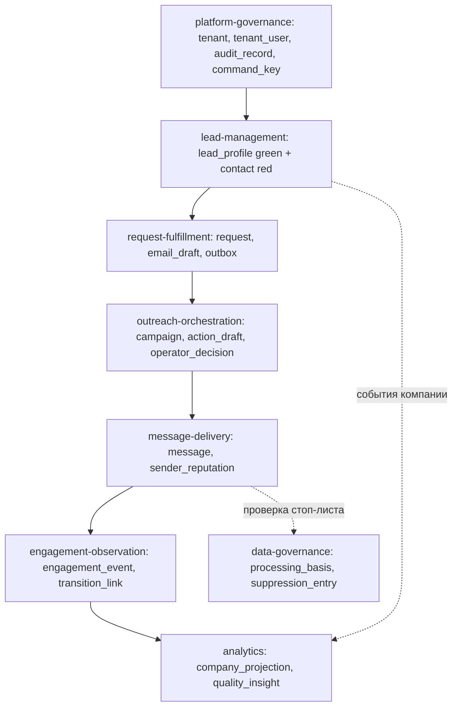

# Справочник физической модели данных

Справочник описывает **физическую** модель данных: какие схемы и таблицы существуют,
что в них лежит, зачем и как они связаны. Это описательный документ, а не назначение
владельцев: владение контекстами, агрегатами и capability задаёт
[`architecture/domain-catalog.yaml`](../architecture/domain-catalog.yaml) и объясняет
[`docs/domain-model.md`](domain-model.md). При расхождении главнее каталог и модель домена.

**Первичный источник факта — SQL-миграции:** `backend/contexts/<context-id>/migrations[/green|red]`
и `backend/platform/consoleauth/migrations/green`. При расхождении документа и миграции
истинна миграция; документ правится в том же change, что меняет миграции (`AGENTS.md` §8).

Смежные документы: обзор сущностей — [`docs/architecture.md`](architecture.md) §5,
сводка персистентности — [`docs/implementation-matrix.md`](implementation-matrix.md) §4.

---

## 1. Принципы

1. **Две зоны — два физических кластера PostgreSQL.** Зелёная зона (платформа) хранит
   агрегаты, обезличенные данные и данные компаний из открытых реестров. Красная зона
   (контур клиента) хранит персональные данные физлиц. Перекрёстного доступа нет: это
   разные кластеры с разными учётными данными.
2. **schema-per-service.** Каждый сервис владеет именованной схемой
   (`CREATE SCHEMA "<context-id>"`). Загрузчик
   [`backend/platform/migrate/apply.go`](../backend/platform/migrate/apply.go) проверяет
   директиву `-- schema:` в файле, создаёт схему, ведёт таблицу `<schema>.schema_migrations`
   и сериализует применение advisory-локом по имени схемы. Выдача отдельной роли СУБД на
   схему и отзыв межсхемных прав **пока не реализованы** (см. §6).
3. **JSONB-снимок агрегата + денормализованные колонки.** Агрегат хранится снимком
   (`snapshot jsonb`), а рядом лежат колонки для запросов, которые нельзя делать по JSONB:
   `tenant_id`, `status`/`state`, `version`/`revision` (оптимистичная блокировка),
   идентификаторы-ссылки. Снимок меняется вместе с кодом снимка.
4. **Transactional outbox.** Доменное событие или сообщение пишется в таблицу `outbox`
   в той же транзакции, что и агрегат, и публикуется relay'ем после commit. Формы outbox
   различаются по контекстам (см. §5).
5. **Ось — `tenant_id`.** Мультитенантность выражается колонкой `tenant_id` и скоупингом
   выборки активным тенантом. RLS как отдельный механизм — см. §6.
6. **Межконтекстные связи — без FK.** Чужая схема не читается; связь идёт через
   идентификаторы в данных и через события. FK существуют только внутри одной схемы (§4).

---

## 2. Карта схем по зонам

| Контекст (схема) | Зона | Таблицы |
|---|---|---|
| `lead-management` | зелёная + красная | `lead_profile`, `search_job`, `search_job_event`, `outbound_message`, `lead_activity`, `email_template`, `lead_assessment` (green); `contact` (red) |
| `request-fulfillment` | зелёная | `request`, `email_draft`, `outbox` |
| `outreach-orchestration` | зелёная | `campaign`, `action_draft`, `operator_decision`, `outbox` |
| `message-delivery` | зелёная | `message`, `sender_reputation`, `outbox` |
| `engagement-observation` | зелёная | `engagement_event`, `signal_ledger`, `transition_link`, `outbox` |
| `analytics` | зелёная | `company_projection`, `report_export_job`, `quality_insight_snapshot`, `quality_insight_application` |
| `audience` | зелёная | `segment`, `audience_snapshot`, `outbox` |
| `content-production` | зелёная | `content_package`, `render_job`, `outbox` |
| `data-governance` | зелёная | `processing_basis`, `suppression_entry` |
| `integration-platform` | зелёная | `adapter_registration`, `adapter_capability`, `integration_invocation`, `vector_document` |
| `platform-governance` | зелёная | `tenant`, `tenant_user`, `audit_record`, `outbox_message`, `command_key` |
| `agent-orchestration` | зелёная | `agent_pipeline`, `agent_run`, `outbox` |
| `consoleauth` (платформенная схема, не контекст) | зелёная | `console_sessions` |

---

## 3. Разбор по контекстам

### `lead-management` — лиды, поиск, письма

Путь миграций: `backend/contexts/lead-management/migrations/{green,red}`.

- **`lead_profile`** (green) — карточка компании (агрегат `lead-profile`) как JSONB-снимок.
  Денормализованы `hidden` (витрина `ListVisible`), `tenant_id` (тенант-скоупная выборка),
  `created_at`/`updated_at`; индекс `lead_profile_tenant_created_idx (tenant_id, created_at DESC, id DESC)`.
  Value object `lead-status` (stage, snooze) живёт внутри снимка — отдельной колонки не требует.
- **`search_job`** (green) — задание поиска. База: `query`, `status`, `result_ref` (JSONB-ссылка
  на найденные компании), `error`, `attempts`. Добавлено миграциями: `budget` (бюджет Firecrawl),
  `max_credits`/`cancel_requested`/`progress`, `error_code`, `plan` (согласованный план обхода),
  `interpretation` (критерии релевантности), `target_companies`/`max_results`.
  Ограничение `search_job_status_check` (`queued/running/done/failed/cancelled`); частичный
  индекс `search_job_queue_idx (created_at, id) WHERE status = 'queued'` — взятие из очереди.
- **`search_job_event`** (green) — append-only журнал жизненного цикла задания: `seq bigint IDENTITY`,
  `job_id`, `type`, `code`, `payload`, `created_at`; индекс `(job_id, seq)`. Операционная запись,
  не доменный агрегат.
- **`outbound_message`** (green) — исходящее письмо (агрегат `outbound-message`) снимком.
  Денормализованы `lead_id` (история переписки, вычисление подавленных) и `status`
  (bounced/unsubscribed/rejected); индекс по `lead_id`.
- **`lead_activity`** (green) — история переходов лида по стадиям: `lead_id`, `stage`, `author`,
  `at`; индекс `(lead_id, at)`. Запись app-слоя.
- **`email_template`** (green) — библиотека шаблонов письма снимком (агрегат `email-template`).
  Денормализованы `name` (порядок) и `revision` (ссылка на редакцию); индекс `(name, id)`.
- **`lead_assessment`** (green) — оценка релевантности компании в разрезе задания. Ключ
  `(job_id, company_id)` (оценка не переносится между заданиями), `verdict`, `signal_kind`,
  `evidence` (JSONB-свидетельства).
- **`contact`** (red) — контакт физлица снимком, денормализован `company_id`. Единственная
  таблица красной зоны.

### `request-fulfillment` — заявки клиента

Путь миграций: `backend/contexts/request-fulfillment/migrations/green`.

- **`request`** — агрегат заявки снимком. Денормализованы `tenant_id`, `status` (очереди
  `ListByStatus`), `version` (оптимистичная блокировка), `updated_at`. Индекс `request_status_idx (status, id)`;
  выраженный `request_campaign_idx (tenant_id, snapshot->>'CampaignID') WHERE snapshot->>'CampaignID' <> ''`
  — сопоставление события доставки с заявкой.
- **`email_draft`** — черновики писем оператора построчно, в порядке найденных лидов (`position`),
  ключ `(request_id, lead_id)` (повторный черновик заменяет прежний, сохраняя место).
  `recipient_ref` — непрозрачная ссылка на контакт; пустая строка = пригодного адреса нет.
- **`outbox`** — платформенная форма публикации: `exchange`, `routing_key`, `body bytea`,
  `headers jsonb`, `published_at`; частичный индекс по `published_at IS NULL`.

### `outreach-orchestration` — кампании и цепочки

Путь миграций: `backend/contexts/outreach-orchestration/migrations`.

- **`campaign`** — агрегат `campaign`: окно (`window_start`/`window_end`), `state`, `tenant_id`;
  `sequence_definitions`/`sequence_executions` (JSONB, снимок цепочек вложен и часто пуст).
- **`action_draft`** — подчинённая сущность `action-draft`: FK `campaign_id ON DELETE CASCADE`,
  `position`, `material_id`, `segment_id`, `recipient_id`, `channel`, `state`, `version`;
  `edits` (правки оператора) и `postponed_until`. Индекс `action_draft_window_idx`.
- **`operator_decision`** — решения оператора по черновикам: FK на кампанию, `draft_id`,
  `draft_version`, `actor_id`, `outcome`, `reason`, `decided_at`, `batch_digest`.
- **`outbox`** — события: `id bigint IDENTITY`, `event_name`, `payload`, `published_at`.

### `message-delivery` — контур отправки

Путь миграций: `backend/contexts/message-delivery/migrations/green`.

- **`message`** — агрегат сообщения снимком. Уникальный `idempotency_key` (повторная команда
  не создаёт второго письма и второго внешнего эффекта), денормализованы `tenant_id`,
  `approved_action_id`, `sender_domain`, `status`/`last_outcome`/`attempts_count` (повторные окна).
- **`sender_reputation`** — репутация отправляющего домена: `domain` (PK), `delivered`,
  `hard_bounces`, `soft_bounces`, `updated_at`.
- **`outbox`** — доменная форма: `event_name`, `payload`, `published_at`.

### `engagement-observation` — доставка, переход, ответ

Путь миграций: `backend/contexts/engagement-observation/migrations/0001_engagement.sql`.

- **`engagement_event`** — событие наблюдения: `kind`, `confidence`, `outcome`, `company_id`,
  `link_ref`, `target`, `correlation_id`/`causation_id`, `version`. Индекс `(tenant_id, id)`.
  Пиксельных метрик нет по построению.
- **`signal_ledger`** — журнал дедупликации входящих webhook: `key` (PK), `marked_at`.
- **`transition_link`** — реестр трекинг-ссылок: `ref` (PK) → `target`, `tenant_id`, `company_id`.
- **`outbox`** — платформенная форма публикации.

### `analytics` — read-модели и отчёты

Путь миграций: `backend/contexts/analytics/migrations`.

- **`company_projection`** — проекция дашборда по ключу `(tenant_id, company_id)` (идемпотентный
  upsert). Стадия воронки и отметки (`found_at`/`sent_at`/`replied_at`), измерения среза
  (`source`, `industry`, `segment`, `campaign_id`, `manager_id`), факты (`delivered`/`transitioned`/
  `unsubscribed`/`bounced`/`won` + признаки `has_*`), качество (`validity`, `duplicate`, `pending_drafts`).
  Текст ответов компаний (`reply_text`) не хранится ни в одной колонке — маскирование на уровне носителя.
- **`report_export_job`** — задания выгрузки отчёта (`platform/jobs`): `payload bytea` (зафиксированный
  фильтр), lifecycle, готовый файл (`result_content_type`/`result_filename`/`result_body`),
  `progress`/`step`/`started_at`, `cancel_requested`.
- **`quality_insight_snapshot`** — read-модель качества поиска: `tenant_id` (PK), `watermark`,
  `formula_version`, `outcomes jsonb` — для воспроизводимости.
- **`quality_insight_application`** — применения рекомендаций со снимком «до»: ключ
  `(tenant_id, scope_kind, scope_key, applied_at)`. Персональных данных нет.

### `audience` — сегменты

Путь миграций: `backend/contexts/audience/migrations/0001_audience.sql`.

- **`segment`** — агрегат `audience-segment` снимком; денормализованы `tenant_id`, `version`;
  индекс `(tenant_id, id)`.
- **`audience_snapshot`** — снимки сегмента (`segment_id`); индекс `(segment_id, id)`.
- **`outbox`** — платформенная форма публикации.

### `content-production` — контент и рендер

Путь миграций: `backend/contexts/content-production/migrations/0001_content.sql`.

- **`content_package`** — агрегат `content-package` снимком; `version` (оптимистичная блокировка).
- **`render_job`** — задания рендеринга: `state` (очередь `ListPending`), `version`; индекс `(state, id)`.
- **`outbox`** — платформенная форма публикации.

### `data-governance` — основания обработки и стоп-лист

Путь миграций: `backend/contexts/data-governance/migrations/0001_processing_basis.sql`.

- **`processing_basis`** — агрегат основания обработки: `purpose_name`, `category`,
  `retention_days`, `valid_from`/`valid_until`, `status`, `version`. Индексы `(tenant_id, id)`
  и `(status, valid_until, id)` (фоновое истечение).
- **`suppression_entry`** — записи стоп-листа: FK `basis_id ON DELETE CASCADE`, `position`, `id`,
  `contact`, `reason`, `active`, `created_at`, `revoked_at`. Частичный индекс `(basis_id, contact)
  WHERE active` — инвариант «активная запись контакта».

### `integration-platform` — реестр адаптеров и вызовы

Путь миграций: `backend/contexts/integration-platform/migrations`.

- **`adapter_registration`** — регистрация адаптера: `adapter_name`, `manifest_version`;
  индекс `(adapter_name)`.
- **`adapter_capability`** — объявленные возможности манифеста: FK `adapter_id ON DELETE CASCADE`,
  `position`, `name`.
- **`integration_invocation`** — журнал вызовов провайдеров: `idempotency_key`, `correlation_ref`,
  `integration_type`, `adapter_name`, `operation`, `state`, `category`, `external_*`,
  `seq bigserial` (детерминирует выбор «последнего» при совпадающих временах).
- **`vector_document`** — векторный индекс семантического recall: `embedding double precision[]`
  (нормализован, косинус = скалярное произведение). Поиск точный перебором, pgvector не требуется.

### `platform-governance` — тенанты, доступ, аудит

Путь миграций: `backend/contexts/platform-governance/migrations`.

- **`tenant`** — агрегат тенанта: `company_name`, `description`, `state`, `version`.
- **`tenant_user`** — пользователи тенанта: FK `tenant_id ON DELETE CASCADE`, `position`, `login`,
  `roles text[]` (набор ролей; прежняя одиночная `role` перенесена и удалена).
- **`audit_record`** — неизменяемый журнал аудита: FK на тенант, `position`, `actor`, `action`,
  `object`, `at`, `outcome`, `correction_of` (пусто у исходной записи).
- **`outbox_message`** — «богатый» outbox платформы: `message_id` (UNIQUE), `contract`,
  `schema_version`, `event_id`, `tenant_id`, `occurred_at`, `correlation_id`, `causation_id`,
  `payload`, `published`.
- **`command_key`** — ключ идемпотентности изменяющей команды: `(tenant_id, command_id)` (PK).

### `agent-orchestration` — пайплайны агентов

Путь миграций: `backend/contexts/agent-orchestration/migrations/green`.

- **`agent_pipeline`** — версии пайплайна снимком, ключ `(tenant_id, pipeline_id, version)`;
  `published` (выборка последней опубликованной версии), `revision` (оптимистичная блокировка).
- **`agent_run`** — запуски агента снимком: `status` (очередь супервизора, подсчёт слотов),
  `revision`. Индекс `(tenant_id, status, id)`; индекс ленты `(tenant_id, updated_at DESC, id DESC)`
  (в `updated_at` — доменное время последнего изменения).
- **`outbox`** — платформенная форма публикации.

### `consoleauth` — сессии консоли (платформенная схема)

Путь миграций: `backend/platform/consoleauth/migrations/green`. Применяется в зелёной зоне.

- **`console_sessions`** — общий стор сессий оператора для всех консолей: `id`, `username`, `csrf`,
  `last_active`. Сессия, выданная входом в одну консоль, принимается другой; `Logout` удаляет
  запись для всех консолей сразу. Права роли консольного сервиса на схему/таблицу выдаёт контур
  развёртывания, а не миграция.

---

## 4. Связи

### 4.1 FK внутри одной схемы (жёсткая целостность)

- `outreach-orchestration`: `campaign` → `action_draft`, `operator_decision` (каскад).
- `data-governance`: `processing_basis` → `suppression_entry` (каскад).
- `platform-governance`: `tenant` → `tenant_user`, `audit_record`.
- `integration-platform`: `adapter_registration` → `adapter_capability`.

### 4.2 Логические связи между контекстами (без FK)

Ось — `tenant_id`; плюс сквозные идентификаторы:

| Ключ | Где встречается | На что логически ссылается |
|---|---|---|
| `company_id` | `analytics.company_projection`, `engagement-observation.engagement_event`/`transition_link`, `lead-management.contact`, `lead_assessment` | компания из `lead_profile` |
| `lead_id` | `lead-management.outbound_message`/`lead_activity`, `request-fulfillment.email_draft` | лид/компания |
| `request_id` | `request-fulfillment.email_draft` | заявка `request` |
| `CampaignID` (в снимке) | `request-fulfillment.request` | `outreach-orchestration.campaign.id` |
| `approved_action_id` | `message-delivery.message` | решение/черновик `outreach-orchestration` |
| `contact` | `data-governance.suppression_entry` | контакт (стоп-лист проверяется перед отправкой) |
| `correlation_id`/`causation_id` | `platform-governance.outbox_message`, `engagement-observation.engagement_event`, `integration-platform.integration_invocation.correlation_ref` | сквозная трассировка причины-следствия |
| `tenant_id` | почти все таблицы | тенант `platform-governance.tenant` |

Поток по контекстам (вертикально):

---

## 5. Сквозные механизмы

- **Идемпотентность.** Уникальные ключи: `message.idempotency_key`,
  `platform-governance.command_key (tenant_id, command_id)`,
  `integration_invocation.idempotency_key`; проекции и снимки идемпотентны по составному PK.
- **Оптимистичная блокировка.** Колонки `version`/`revision`: `request`, `audience.segment`,
  `content_package`, `render_job`, `processing_basis`, `agent_pipeline`, `agent_run`,
  `engagement_event` (обновление `WHERE version = $expected`).
- **Append-only журналы.** `search_job_event`, `platform-governance.audit_record`,
  `engagement-observation.signal_ledger`, подчинённые таблицы с `position`.
- **Частичные индексы под очереди.** `WHERE status = 'queued'`, `WHERE published_at IS NULL`,
  `WHERE active`, `WHERE published`.
- **CHECK-инварианты.** `search_job_status_check` (допустимые статусы задания).
- **Формы transactional outbox.**
  - «Богатая» (`platform-governance.outbox_message`): contract/schema_version/event_id/correlation/causation.
  - «Публикационная» (`exchange`/`routing_key`/`body`/`headers`): `request-fulfillment`, `audience`,
    `content-production`, `engagement-observation`, `agent-orchestration`.
  - «Доменная» (`event_name`/`payload`): `outreach-orchestration`, `message-delivery`.

---

## 6. Известные расхождения (факт, не цель)

Расхождения между декларацией и кодом зафиксированы здесь, чтобы справочник не выдавал
незакрытое за готовое. Они **не закрываются** этим документом.

| Расхождение | Факт по коду | Владелец / статус |
|---|---|---|
| Роли schema-per-service | Схемы и `<schema>.schema_migrations` создаются загрузчиком (`backend/platform/migrate/apply.go`), но отдельная роль СУБД на схему и отзыв межсхемных прав не выданы | change `service-per-context` (design, Решение 4) |
| RLS по тенанту | Политик `CREATE POLICY` / `ENABLE ROW LEVEL SECURITY` в миграциях нет; изоляция — колонкой `tenant_id` и скоупингом в запросах. Ранее признано в изменениях `tenant-context-visibility`, `tenant-scoped-lead-storage` | открытый факт |
| PII красной зоны | В красной зоне материализован только `contact`; сущности provenance/verification из `docs/architecture.md` §5 не заведены | открытый вопрос без владельца |

Разделение ролей СУБД в рамках этого справочника **не делается** — зафиксировано как чужая
зона ответственности (`service-per-context`).

---

## 7. Как обновлять

- Первичный источник — файлы миграций. При добавлении/изменении миграции правьте соответствующий
  раздел §2–§5 в том же change.
- Не переносите в справочник назначение владельцев и состав агрегатов — это делает
  `architecture/domain-catalog.yaml` и `docs/domain-model.md`.
- Новое расхождение между декларацией и кодом фиксируйте в §6 с фактом и владельцем/статусом,
  а не «замазывайте» формулировкой «должно быть».
